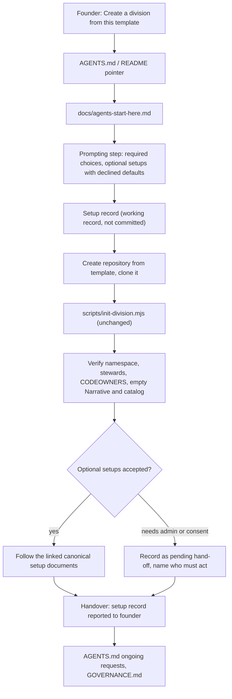

# Agents start here

**Feature:** [#189](https://github.com/jamiemitchellconsultants/division-ontology/issues/189) (lite mode)

## Product owner — vision

**Status:** Accepted by the product owner on 24 November 2026.

### Problem

This repository is a GitHub template for starting a new division, but an agent asked to create a division from it has no instructed path for doing so. The human-facing README describes clicking **Use this template** and running `init-division`, and `AGENTS.md` — the canonical agent instruction file — only covers operating a division that already exists (“Add `owner/repo`…”, “Join `owner/repo`…”, “Sync division ontology now”). An agent asked to start a division must improvise the template-creation and cloning steps, and nothing requires it to ask the user about the template’s optional setups. It can silently skip them, enable them without consent, or present a partial setup as complete.

### Users

- **Division founder:** the person asking an agent to create a new division repository from this template. They own the choices the agent cannot invent: target repository, namespace, stewards, and which optional setups they want.
- **Coding agent:** the agent carrying out the setup on the founder’s behalf. It needs one discoverable, ordered path from template creation to a verified, handed-over division, with explicit stop conditions.
- **Division steward (incoming):** one of the logins the founder names. They inherit the created repository and need the setup record — what was enabled, what was declined, and what still needs their or an administrator’s action — to govern it.

### Outcomes and measures

1. **An agent can create and initialise a division without inventing steps.** Measure: following only the new instructions, an agent creates a scratch division from the template, initialises it, and the result matches what `init-division` guarantees — the founder’s namespace and stewards in `division.json`, the core and CODEOWNERS rewritten, an empty Narrative, no registered sources, and a rebuilt catalog. A walkthrough that needs knowledge the instructions do not supply is a failure.
2. **The agent prompts for every setup choice instead of assuming it.** Measure: before proceeding, the agent asks about and records answers for the required choices (target owner/name, division namespace, steward logins, and confirmation that a public repository publishing source ontologies is intended) and for each optional setup: deploying the runtime knowledge workspace versus catalogue-only; an embedding/semantic-search provider if the workspace is deployed; the C4 impact pilot; granted-source onboarding via the dedicated source-read App versus steward-registered sources only; and enabling auto-merge for verified catalogue pull requests. For each optional setup the prompt states the default when declined. No optional setup is enabled, or reported as skipped, without the user’s recorded answer.
3. **Nothing is claimed done that needs someone else’s access.** Measure: where a step needs GitHub App creation or installation, branch-protection changes, steward approval, or a private-source owner’s publication consent, the instructions make the agent stop, hand off, and record the item as pending. The agent never invents a namespace, steward, or ontology content, and never puts credentials in files or command arguments.
4. **The result points onward instead of duplicating rules.** Measure: the instructions end by directing the agent and founder to the existing canonical homes — `AGENTS.md` for ongoing agent requests, `GOVERNANCE.md` for shared-term and link decisions, the automation setup for App and branch-rule administration, and the workspace runbook if the workspace was chosen — and restate none of their rules. Semantic similarity is described only as a discovery aid, never as automatic linking or equivalence.
5. **A division copy keeps the instructions.** Measure: the document survives `init-division` in a fresh copy (it is not template history removed during initialisation), and the copy’s stewards own it through CODEOWNERS like `AGENTS.md`.

### Scope

- An agent-facing “Agents start here” instruction document covering, in order: preconditions and the prompting step (Outcome 2); creating the repository from the template and cloning it; initialising it once, before any sources are registered; reviewing the resulting diff; completing or handing off the one-time automation setup; verifying the first sync; and handing over with a record of what was enabled, declined, and left pending.
- The prompting step itself: the questions to ask, the default for each declined optional setup, and where the agent records the answers before proceeding.
- Making the document discoverable from the existing canonical entry points (`AGENTS.md` and the README’s agent instructions) with pointers, without duplicating their content.
- Tests or checks that pin the document’s presence, its prompting requirement, and its survival in an initialised division copy.

### Out of scope

- Creating a real division, registering real sources, or granting any GitHub App access as part of this feature. The document instructs those steps; performing them for a live division is the founder’s separate request.
- New setup automation. The document uses the existing template mechanism and `init-division`; writing a creation script or changing `init-division` behaviour is not in scope (a gap found there is parked as a side issue).
- Choosing an embedding model, workspace deployment target, or any other optional setup for a particular division. The document makes the agent ask; the founder decides.
- Changing catalogue, builder, merge-policy, or workspace behaviour, and any form of automatic semantic linking or equivalence from similarity.
- Duplicating or replacing `AGENTS.md`, `GOVERNANCE.md`, or the automation-setup document.

### Research

- **The template mechanism is real but human-addressed.** GitHub reports this repository as a template (`isTemplate: true`). [README.md](../../../README.md) “Start a new division from this template” gives the human steps: **Use this template**, `npm ci`, `npm run init-division -- --namespace … --steward …`, review and commit, then the one-time automation setup.
- **Agent instructions start after creation.** [AGENTS.md](../../../AGENTS.md) is canonical (all other tool instruction files are thin pointers to it), and its “Short agent requests” plus the README’s “Minimal instructions for an agent” cover only adding/joining a source and syncing an existing division. `.agents/skills/` contains only the `feature-*` persona skills; there is no creation skill or agent request phrase for instantiating the template.
- **Initialisation is scripted and checkable.** [scripts/init-division.mjs](../../../scripts/init-division.mjs) refuses a copy with registered sources, rewrites the namespace in the core, `division.json`, and CODEOWNERS, empties the Narrative, removes template history and the template-only tests, and rebuilds `dist/`. [test/init-division.test.mjs](../../../test/init-division.test.mjs) already asserts these effects on a scratch copy, which Outcome 1’s walkthrough can build on.
- **Optional setups are documented but scattered.** The workspace is optional (a division can run catalogue-only); embedding search is optional and the catalogue and C4 pilot work without a model ([docs/adding-embedding-search.md](../../../docs/adding-embedding-search.md)); the dedicated source-read App enables granted sources while a single-App setup still serves registered ones; and catalogue auto-merge stays off until `DIVISION_AUTO_MERGE_READY` is set after the merge-policy gate is verified ([docs/automation-setup.md](../../../docs/automation-setup.md)). Nothing today makes an agent ask about any of them.
- **Guardrails the document must not blur.** Similarity may inform human link review but never creates links or equivalence ([GOVERNANCE.md](../../../GOVERNANCE.md)); registering or granting a private source publishes its ontology in this public repository, so owner consent is a stop condition, and an agent cannot grant itself App access ([AGENTS.md](../../../AGENTS.md)).

## Analyst — behaviours

**Status:** Accepted by the user on 24 November 2026.

**Basis:** the accepted vision above, the product-owner handoff on #189, and the analyst decisions recorded with the user below. Each numbered outcome matches the vision. Scenarios specify observable behaviour of the agent following the instructions, and of the instructions themselves; they do not prescribe components or file layout.

### Behaviours

#### Outcome 1 — An agent can create and initialise a division without inventing steps

- **B1 — Create from the template.** **Given** the required choices of B5 are recorded, **when** the agent follows the instructions, **then** it creates the target repository from this template and clones the new repository, working in that clone from then on. If template creation fails, no initialisation is attempted in the template repository itself.
- **B2 — Initialise once, before any sources.** **Given** a fresh clone with no registered sources, **when** the agent initialises it with the recorded namespace and steward logins, **then** initialisation runs exactly once, before any source is registered, and the agent reviews the resulting diff before any commit.
- **B3 — Verify the initialised division.** **Given** initialisation has run, **when** the agent checks the result, **then** `division.json` holds the recorded namespace and stewards, the core and CODEOWNERS use them, the Narrative is empty, `sources.json` registers no sources, and the catalog is rebuilt in the new namespace. Any mismatch is reported, not passed over.
- **B4 — Instructions-only walkthrough.** **Given** a tester with only the instructions and a set of recorded choices, **when** they follow the instructions against a scratch copy, **then** the initialised result of B3 is reached without knowledge the instructions do not supply. A step that needs outside knowledge is recorded as a failure of the instructions. The walkthrough creates no real GitHub repository (see U3).

#### Outcome 2 — The agent prompts for every setup choice instead of assuming it

- **B5 — Prompt for required choices before creation.** **Given** a request to create a division, **when** the agent starts, **then** it asks for and records the target owner/name, the division namespace, the steward logins, and confirmation that a public repository publishing source ontologies is intended. No repository is created until all four are recorded; the agent invents none of them.
- **B6 — Prompt for each optional setup, with its declined default.** **Given** the required choices are recorded, **when** the agent reaches the prompting step, **then** it asks about each of these by name, stating the default that applies if declined: deploying the runtime knowledge workspace (default: catalogue-only); an embedding/semantic-search provider, asked when the workspace is chosen (default: no semantic search, existing catalogue and text search only); the C4 impact pilot (default: not set up; the empty registries stay empty); granted-source onboarding via the dedicated source-read App (default: steward-registered sources only); and enabling auto-merge for verified catalogue pull requests (default: catalogue pull requests wait for steward review). A prompt that names a setup without its declined default does not meet this behaviour.
- **B7 — Record every answer before proceeding.** **Given** the prompts of B5 and B6, **when** the agent proceeds past the prompting step, **then** each choice stands recorded as accepted, declined, or defaulted (B8), and that record is what the handover of B9 shows. An enabling step for an optional setup runs only when its recorded answer is accepted.
- **B8 — An unanswered prompt defaults, visibly.** **Given** the user declines to answer an optional-setup prompt, **when** the agent continues, **then** it applies the declined default of B6, records that item as “defaulted — not answered” (never as accepted or declined), and continues. Required choices of B5 are not defaulted: setup stops until they are answered.
- **B9 — Hand over the setup record.** **Given** setup reaches handover, **when** the agent reports completion, **then** the report lists every required choice, every optional setup as accepted, declined, or defaulted, and every pending hand-off of B11. An optional setup is never reported simply as “skipped”.

#### Outcome 3 — Nothing is claimed done that needs someone else’s access

- **B10 — Stop rather than invent.** **Given** a required choice is missing, or template creation or initialisation reports an error, **when** the agent cannot proceed from recorded answers, **then** it stops, reports what is missing or failed, and creates or changes nothing further. A failed run leaves any previously published catalog untouched.
- **B11 — Hand off administrator steps as pending.** **Given** a chosen setup needs GitHub App creation or installation, branch-protection or required-check changes, steward approval, or a private-source owner’s publication consent, **when** the agent reaches that step without the needed access, **then** it records the step as pending, names who must do it, and does not report the setup as complete. The agent never grants itself App access and never puts credentials in files or command arguments.
- **B12 — No secrets in the record.** **Given** the setup record of B9, **then** it contains choices and pending steps only — no token, private key, or password, in the record or in any file the agent wrote during setup.

#### Outcome 4 — The result points onward instead of duplicating rules

- **B13 — Point to the canonical homes.** **Given** a reader finishes the instructions, **when** they look for how to operate the division, **then** the instructions direct them to `AGENTS.md` for ongoing agent requests, `GOVERNANCE.md` for shared-term and link decisions, the automation setup for App and branch-rule administration, and the workspace runbook if the workspace was chosen. The instructions restate none of those documents’ rules.
- **B14 — Similarity is discovery only.** **Given** any mention of semantic search or similarity in the instructions, **then** it is described as a way to find records for human judgement. No instruction tells the agent to create a link, an equivalence, or any ontology relationship from a similarity match, and same-labelled concepts are described as staying distinct.

#### Outcome 5 — A division copy keeps the instructions

- **B15 — The document survives initialisation.** **Given** a fresh copy initialised as in B2, **when** its files are inspected, **then** the “Agents start here” document is still present and unchanged in substance (it is not removed as template history).
- **B16 — The copy’s stewards own the document.** **Given** the initialised copy of B15, **when** its CODEOWNERS is inspected, **then** the document is assigned to the copy’s recorded steward logins, as `AGENTS.md` is.

### Uncertainties

| ID | Question | Decision or explicit deferral | Basis |
| --- | --- | --- | --- |
| U1 | What makes “prompted” testable? | B5–B9: named prompts, each stating its declined default; every answer recorded as accepted, declined, or defaulted before any enabling step; the record is shown at handover. | Product-owner handoff question; analyst decision. |
| U2 | What if the user will not answer an optional prompt? | Apply the declined default, record “defaulted — not answered”, and continue (B8). Required choices are never defaulted. | Decided by the user in analyst review. |
| U3 | What evidence proves Outcome 1? | A scratch-copy initialisation following only the instructions, asserting B3; no real GitHub repository is created (B4). | Decided by the user in analyst review. |
| U4 | Is the optional-setup list complete? | The five setups of B6 are the required minimum for this feature, closed from the current template inventory. A later optional feature amends the list by changing these behaviours. | Analyst decision from the documented optional features. |
| U5 | Is new setup automation needed? | No. Documenting the existing template mechanism and `init-division` is the feature’s scope; a gap needing script changes is parked as a side issue. | Vision scope and out-of-scope. |
| U6 | Are pointers from AGENTS.md and README discoverable enough, without a new skill? | Yes, for this feature: `AGENTS.md` is the canonical file every agent tool is pointed at. A dedicated skill is deferred as out of scope. | AGENTS.md pointer structure; vision scope. |
| U7 | Does this feature introduce domain terms? | No new division knowledge concept is introduced, so `core/ontology.ttl` is unchanged. | Vision and Terms below. |

### Terms

This feature introduces no domain term, so `core/ontology.ttl` is unchanged. The words below are vocabulary of the instructions, not ontology concepts:

- **Setup record:** the recorded required choices, each optional setup’s state (accepted, declined, or defaulted — not answered), and the pending hand-offs, handed over at the end of setup (B7, B9).
- **Declined default:** the state that applies when an optional setup is declined or defaulted, as stated in its prompt (B6, B8).
- **Pending hand-off:** a step recorded as needing a named person’s access or approval before the setup can be called complete (B11).

Existing terms used unchanged: division steward (`division.json`), granted source, and the reviewed link kinds `exact` and `specializes`.

## Architect — structure

**Status:** Accepted by the user on 24 November 2026.

**Basis:** the accepted vision and behaviours above, the analyst handoff on #189, and the current repository structure: `AGENTS.md` canonical with thin pointers to it, `scripts/init-division.mjs` and its scratch-copy test, `test/onboarding-docs.test.mjs`, and `.github/CODEOWNERS`.

### Components

| Component | Responsibility | Behaviours |
| --- | --- | --- |
| **Start-here document** (`docs/agents-start-here.md`, new) | The single ordered runbook for creating a division: prompting step, template creation and clone, one-time initialisation, diff review, automation-setup completion or hand-off, first-sync verification, and handover. It states each prompt, declined default, stop condition, and pending hand-off, and links to canonical documents instead of restating them. It is titled “Agents start here”. | B1–B16 |
| **Canonical pointers** (`AGENTS.md`, `README.md`) | Make the document discoverable where agents already look: a short “Creating a division from this template” pointer in `AGENTS.md`, including the agent request phrase “Create a division from this template”, and one line in the README’s “Minimal instructions for an agent”. Pointers name the document and nothing else — no rules are copied. | B1, B5, B13 |
| **Prompting step and setup record** (a section of the start-here document, enacted by the agent) | Presents the four required choices and the five optional setups, each optional prompt carrying its declined default from B6. Answers are recorded in the agent’s working record during setup and reported to the founder at handover in the document’s table form: each item as accepted, declined, or defaulted — not answered, plus pending hand-offs. The record is a conversation artefact reported to the founder; it is not committed to either repository, and it carries no secrets. Choosing an optional setup sends the agent to that setup’s existing canonical document; the start-here document does not contain the setup instructions themselves. | B5–B9, B11, B12 |
| **Existing initialiser** (`scripts/init-division.mjs`, unchanged) | Refuses a copy with registered sources; rewrites the namespace in the core, `division.json`, and every CODEOWNERS entry; empties the Narrative; removes template history and the template-only tests; rebuilds `dist/`. The start-here document drives it and verifies its effects; no behaviour change is made to it in this feature. | B2, B3, B10, B15, B16 |
| **Linked setup and operation documents** (existing, unchanged) | The automation setup (Apps, branch rules, auto-merge), the embedding-search guide, the C4 pilot material, the workspace runbook, `GOVERNANCE.md`, and `AGENTS.md`’s ongoing agent requests. Accepted optional setups and all ongoing operation follow these; the start-here document only links, with the condition for following each link (for example, the workspace runbook only when the workspace was chosen). | B6, B11, B13, B14 |
| **Contract tests** (`test/onboarding-docs.test.mjs` and `test/init-division.test.mjs`, extended) | Pin the document’s content and survival without creating a real GitHub repository. The onboarding-docs tests assert the document exists and contains: the four required prompts; each of the five optional setups named with its declined default; the three answer states including “defaulted — not answered”; the stop and pending-hand-off wording; the canonical links of B13; and similarity described as discovery only. They also assert the `AGENTS.md` and README pointers exist. The init-division tests extend the existing scratch-copy flow (which already copies `docs/`) to assert the document is present after initialisation and that its CODEOWNERS entry was rewritten to the new stewards. | B3–B9, B13–B16 |
| **CODEOWNERS entry** (`.github/CODEOWNERS`) | One added line, `/docs/agents-start-here.md`, beside the existing `/AGENTS.md` line. Because the initialiser rewrites every non-comment CODEOWNERS line to the new stewards, the entry transfers ownership in a division copy with no code change. | B16 |

### Structure

The start-here document is the only new artefact of substance. Everything it drives — the initialiser, the setup documents, CODEOWNERS transfer — already exists; the tests reuse the two existing test files that already pin onboarding documents and scratch-copy initialisation.

### Deployment and runtime

There is no runtime component and no deployment. The document ships in the template, is read by an agent only while a division is being created, and survives into every division copy, where the copy’s stewards own it. The tests run under the existing `npm test` (`node --test`), using the init-division scratch copies under the system temp directory; they need no GitHub credentials and create no real repository (U3). No ontology, catalogue, builder, merge-policy, or workspace files change.

### Traceability

| Behaviour | Components |
| --- | --- |
| B1 | Start-here document, canonical pointers |
| B2 | Start-here document, existing initialiser |
| B3 | Existing initialiser, contract tests |
| B4 | Start-here document, contract tests |
| B5 | Prompting step and setup record, canonical pointers |
| B6 | Prompting step and setup record, linked setup documents |
| B7 | Prompting step and setup record |
| B8 | Prompting step and setup record |
| B9 | Prompting step and setup record |
| B10 | Start-here document, existing initialiser |
| B11 | Prompting step and setup record, linked setup documents |
| B12 | Prompting step and setup record |
| B13 | Canonical pointers, linked setup and operation documents, contract tests |
| B14 | Linked setup documents, contract tests |
| B15 | Existing initialiser, contract tests |
| B16 | CODEOWNERS entry, contract tests |

### Decisions

- [ADR 0027 — Give “Agents start here” its own document, pointed to from the canonical entry points](../../adr/0027-agents-start-here-in-own-document.md)

## User

**Status:** User guide and acceptance accepted by the user on 24 November 2026; local-build layer passed, deployed layer pending the build pull request merge.

### Runbook

#### Deploy

There is nothing to install or deploy. The feature ships as documents and tests in this template repository: merging the build pull request puts `docs/agents-start-here.md`, its `AGENTS.md` and README pointers, and its CODEOWNERS line on `main`, where any agent pointed at this repository — and any division created from it afterwards — picks them up. The deployed environment for acceptance is therefore this repository on `main` after the build pull request merges: the same documents a founder’s agent would read from GitHub. A division created before this feature merged does not gain the document automatically; its stewards can copy `docs/agents-start-here.md` in and add the CODEOWNERS line through their own reviewed pull request.

1. Review and merge the build pull request for this feature.
2. Confirm on `main`: `docs/agents-start-here.md` exists, `AGENTS.md` and `README.md` point at it, `.github/CODEOWNERS` carries its line, and `npm test` passes.

#### Operate

- **Founder:** ask an agent to “Create a division from this template”, then answer its prompts. The agent must ask for the four required choices (target owner/name, division namespace, steward logins, and confirmation that a public repository publishing source ontologies is intended) and for each optional setup, stating the default that applies if you decline: workspace (catalogue-only), embedding provider (no semantic search), C4 pilot (not set up), granted sources via the source-read App (steward-registered sources only), and catalogue auto-merge (steward review). You may leave an optional prompt unanswered: the agent applies the default and records it as “defaulted — not answered”. At handover you should receive the setup record: every choice, every optional setup’s state, and every pending step with the person who must do it. If a handover just says a setup was “skipped”, send it back.
- **Agent:** follow `docs/agents-start-here.md` in order — prompt, create and clone, initialise once, verify, follow the linked documents for accepted setups, verify the first sync, hand over the setup record. Stop rather than invent a missing required answer; record administrator and consent steps as pending, naming who must act; never put credentials in a file or a command argument.
- **Incoming steward:** govern the created division from the setup record. Pending hand-offs (App administration, branch rules, approvals) are yours or a named administrator’s to complete, after which the division is operated through `AGENTS.md` and `GOVERNANCE.md` as usual.

Health check for the document itself: `node --test test/onboarding-docs.test.mjs` and `node --test test/init-division.test.mjs` pass, and `node scripts/feature.mjs check-frontmatter --feature 189` reports ok.

#### Recover

- **A setup is going wrong mid-run:** stop. A missing required answer, a failed template creation, or a failed initialisation changes nothing further; any previously published catalog is untouched. Fix the cause (the answer, the permission, the failing source) and start again from the failed step of `docs/agents-start-here.md`.
- **The document itself is wrong:** fix it through this repository’s normal reviewed pull request. If the error is in the prompting step or a default, that is a change to the analyst’s behaviours — raise it through the feature workflow rather than editing wording to mean something else. Reverting the build pull request removes the document and its pointers together; divisions already created keep their copies, which their stewards own.
- **A division was created with the wrong namespace or stewards:** do not rewrite it casually. Shared IRIs are stable once published; the division’s stewards decide through their own governance whether a correction or a fresh division is right.

### User guide

Written for the three users named in the vision. Behaviour numbers match the analyst section.

- **Founder — ask for a division (B5).** Say “Create a division from this template” to an agent working in this repository. Expect four questions before anything is created: where the new repository goes, its namespace, who stewards it, and whether a public repository is intended. If you are not asked, the agent is not following the instructions.
- **Founder — choose the optional setups (B6–B9).** Expect five more prompts, each naming its default: deploying the workspace, an embedding provider for it, the C4 pilot, granted sources via the source-read App, and catalogue auto-merge. Answer, decline, or leave one unanswered — unanswered means the default applies and is recorded as “defaulted — not answered”, never as a choice you made. Your receipt is the setup record at handover: choices, states, and pending steps, never just “skipped”.
- **Agent — create and initialise (B1–B4).** Follow the document in the new clone: create from the template, initialise once before any sources with the recorded namespace and stewards, then verify `division.json`, the core, CODEOWNERS, the empty Narrative and sources, and the rebuilt catalog. Report mismatches; commit only when the founder asks.
- **Agent — know when to stop (B10–B12).** A missing required answer, a creation or initialisation failure, an administrator step, or a needed consent all stop the run. Record the step as pending, name who must do it, and claim nothing complete. Keep every credential out of files, command arguments, and the setup record.
- **Agent and founder — after handover (B13–B14).** Ongoing work lives in `AGENTS.md` (“Add…”, “Join…”, “Sync division ontology now”), `GOVERNANCE.md`, the automation setup, and the workspace runbook when the workspace was chosen. Semantic similarity is only ever a way to find records for human judgement; it creates no link or equivalence, and same-labelled concepts stay distinct.
- **Steward — inheriting the document (B15–B16).** The division copy keeps `docs/agents-start-here.md`, and its CODEOWNERS line is rewritten to you at initialisation, so the next agent in your division finds the same starting point owned by the right people.

### Acceptance

There are no quality attribute ids in this feature, so acceptance is the behaviour layers only. Follow the walkthroughs first and record pass or fail for each numbered step. Then inspect the named executable tests, approve them, and run them: first in the local build, then in the deployed environment (this repository on `main` after the build pull request merges). Record the date and the person who did each walkthrough. Executable cases: `test/onboarding-docs.test.mjs` (“agents start here …” and pointer tests) and `test/init-division.test.mjs` (“a fresh copy gets its own namespace, stewards, empty narrative and catalog”), plus the full `npm test` run.

#### B1–B4 — Create, initialise, verify, walkthrough

1. Starting only from `docs/agents-start-here.md` and a recorded set of invented choices, follow steps 2–3 against a scratch copy. Expect the repository steps to use the template mechanism and the recorded namespace and stewards, exactly once, before any sources.
2. Check the scratch result: `division.json`, the core namespace, CODEOWNERS, the empty Narrative, the empty `sources.json`, and the rebuilt catalog all agree with the recorded choices. Executable: the init-division case, which asserts each of these.

#### B5–B9 — Prompting and the setup record

1. Read the prompting step. Expect four required choices, each marked never-defaulted, and five optional setups, each naming its declined default exactly as the behaviours specify.
2. Trace one accepted, one declined, and one unanswered optional setup through the document. Expect the unanswered one to take its default and be recorded “defaulted — not answered”, and the handover to list all three states and never “skipped”. Executable: the required-choices, optional-setup, and states/hand-offs cases in `test/onboarding-docs.test.mjs`.

#### B10–B12 — Stops and pending hand-offs

1. Find each stop in the document: missing required answer, failed creation or initialisation, administrator step, missing consent. Expect each to stop the run, change nothing further, and leave any published catalog untouched.
2. Check the record rules: pending steps name who must act, and no token, private key, or password appears in the record or in any file the setup writes. Executable: the states/hand-offs case; the secret-free record is inspection, confirmed here.

#### B13–B14 — Pointers and similarity

1. From the end of the document, reach `AGENTS.md`, `GOVERNANCE.md`, the automation setup, and the workspace runbook reference without the document restating their rules.
2. Read every similarity mention. Expect discovery-for-judgement wording only, distinct identities for same-labelled concepts, and no instruction to create a link from a match. Executable: the canonical-homes case, including its negative match assertion.

#### B15–B16 — Survival and steward ownership

1. In the scratch copy from B1–B4, confirm `docs/agents-start-here.md` is present and its substance unchanged after initialisation.
2. Confirm its CODEOWNERS line now names the recorded stewards. Executable: the init-division case, whose survival assertion was shown during the build to fail when the document is renamed away.

#### Results — local build (24 November 2026, Muse Code session acting as user, branch `feature/agents-start-here/build`)

- Walkthroughs B1–B16: followed during the build (Tasks 1–5) and re-checked for this section. B1–B4 and B15–B16 were exercised by the scratch walkthrough with invented values (`https://example.test/sales-division#`, `sales-steward`), which produced the recorded division, an empty `sources.json`, a catalog in the new namespace, and the rewritten CODEOWNERS line; the scratch copy was deleted. B5–B14 were followed by reading the document against each behaviour. **Pass.**
- Executable tests: `npm test` — 309 pass, 0 fail, including the five new onboarding-docs cases and the extended init-division case. The survival assertion was also shown to fail with the document renamed away, then pass restored. **Pass, pending the user’s approval of the tests below.**

#### Results — deployed environment

- To be run after the build pull request merges, repeating the walkthroughs against this repository on `main`, and recorded here by amendment. Until then this layer is open and its checklist criterion stays unticked.
