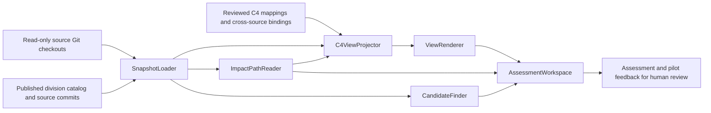

# C4 diagrams from source knowledge graphs — architecture

**Feature:** [#7](https://github.com/jamiemitchellconsultants/division-ontology/issues/7)

**Phase:** [#17 — Architect structure](https://github.com/jamiemitchellconsultants/division-ontology/issues/17)

**Status:** Accepted by the product owner on 4 November 2026; pending review and merge of the architect phase pull request.

This design serves the [accepted behaviours](02-behaviours.md). The first pilot is a local Node.js command-line tool over pinned source checkouts. It produces deterministic, inspectable C4 views and an architect-authored assessment for review. It does not turn a search match or an empty graph result into an impact conclusion.

## Components

| Component | Responsibility | Behaviours |
| --- | --- | --- |
| `SnapshotLoader` | Reads one published `dist/catalog.json`, its division commit, and every participating source at exactly the commit recorded in that catalog. Verifies source identity and commit availability before combining facts. Loads source graph, graph schema and coverage from that commit where present; reports absent graph support as a gap. | B1, B5–B15 |
| `C4MappingRegistry` | Holds reviewed, versioned presentation mappings from source graph node IRIs and assertion IRIs to C4 level, boundary and focus. A mapping cites the source fact that supports it. It does not change source-owned ontologies or assert equivalence from names. Unmapped or unsupported classifications stay unresolved. | B5–B9, B11, B13–B15 |
| `CrossSourceBindingRegistry` | Holds reviewed bindings between an external node named in one participating graph and the source-owned node in another participating graph. A binding cites the source assertion, its evidence and the reason the identities match. It never creates an ontology `exact` link or collapses two node IDs. | B2, B5, B10–B11, B14 |
| `CandidateFinder` | Searches source graph labels and the published catalog's concepts/definitions for terms in a change request. Returns ranked leads with the matching text, node or concept IRI, repository, commit and evidence status. Accepts an exact IRI to bypass lexical search. An unsupported match remains a lead, not an impact claim. | B1, B10–B11, B13 |
| `ImpactPathReader` | Traverses bounded, direction-preserving graph assertions from architect-confirmed starting nodes. Each step keeps its assertion IRI, direct/inferred basis, source evidence and source commit. A cross-source transition requires an explicit reviewed binding and is labelled as such; a multi-step path is never summarized as a direct edge. | B2, B10–B13 |
| `C4ViewProjector` | Builds a deterministic view model for system context, container, component or code from mapped, supported facts at one snapshot. Carries focus, boundaries, item citations and coverage gaps into each level; a missing next level remains visible. For code, it can attach an architect-inspected source location at the pinned commit when graph projection is inadequate. | B5–B13 |
| `ViewRenderer` | Emits stable JSON plus a Markdown report with Mermaid diagrams, a legend, an evidence table and a gap table. Diagram clicks or IDs lead to the corresponding evidence entry and commit-pinned source location. The JSON remains usable without Mermaid. | B5–B13 |
| `AssessmentWorkspace` | Creates a local, editable assessment record tied to the snapshot and change request. The architect confirms candidates, marks likely or not expected impacts with reasons, attaches exact path/evidence references, and records unresolved questions. The tool checks references and renders a reviewable Markdown assessment; a human reviews it through the change request's normal review process. | B1–B4, B9–B13 |
| `PilotFeedbackRecord` | Captures architect and reviewer feedback on perceived accuracy, completeness, discoveries, suspected misses, false leads, confidence, examples and open questions alongside the assessment. It imposes no numeric accuracy gate. | B4 |

## Structure

The catalog is the participating-source inventory and source-revision lock. Its existing `sources`, `concepts`, `relations` and N-Quads remain authoritative for the published ontology. The source knowledge graph is a separate, optional artifact read at the **same recorded source commit**. The tool uses its `GraphNode`, `GraphAssertion`, `GraphEvidence` and `GraphCoverage` contract; it does not treat the catalog's ontology relation definitions as instance edges. A `PublishedKnowledgeSnapshot` is identified by the division catalog commit, the catalog content digest and its recorded source commit set. The mapping and binding revision is included in each generated view and assessment. Repeating the same inputs yields the same supported view model and gap report.

The mapping registry is division-owned reviewed data. Entries name source IDs, source-owned graph IRIs, C4 level and parent boundary, and supporting assertion/evidence IRIs. `kit:system` can map to a software system when evidence supports it; `kit:component` alone does not decide whether an item is a C4 container or component. Code nodes can map from `kit:source-symbol` only with an evidenced component parent. A C4 person or external system needs a declared source kind and evidence. A missing level, ambiguous parent, missing node support or unsupported item is reported as incomplete or unavailable. The mapping is a presentation decision, not a claim that equal names identify the same thing.

Source graphs currently require assertion endpoints to resolve to nodes in their own graph. For a cross-repository path, a participating source may describe an external node and an evidenced assertion to it. The binding registry may associate that external node with a node in another participating source **only after review of identity evidence**. The view shows the underlying source assertion and the reviewed binding separately in its evidence trail. Without a binding, the external node remains context; its repository does not enter the participating inventory. A source with no graph remains a valid catalog source with C4 coverage shown as unavailable rather than being rejected.

Search, path traversal and projection use the graph's declared kinds and relationships and explicit registry entries. A catalog concept match without a supported graph node can be shown as a lead but cannot become a C4 starting element. The tool never infers an edge, parent, equivalence or impact from matching labels. Direct and inferred graph assertions retain their recorded basis; inferred ones show their cited observations. Coverage selectors report covered, unknown or excluded files, but file coverage alone does not certify complete architectural knowledge. Every empty search, path or level result carries an unknown or reasoned gap statement, not a no-impact conclusion.

The code view first uses supported graph facts. Where these are insufficient, the architect may inspect code in a read-only checkout at the catalog commit and attach a repository-relative path, line range, blob ID and reason to a local view supplement. The supplement is visibly architect-inspected and applies only to that assessment. It is not written back to the source graph or silently promoted into the shared catalog. If the inspected location cannot be verified at the pinned commit, it is not shown as supported code evidence.

The assessment is an editable local JSON record with a deterministic Markdown rendering. It names the request, snapshot, mapping revision, confirmed and rejected leads, likely affected elements, individual paths, reasons, evidence references and unresolved gaps. An architect owns its conclusions. Reviewers see the rendered record and can challenge individual claims; no command approves a change request. Feedback is a separate record attached to the assessment so pilot observations do not alter source facts.

## Deployment and runtime

- Run the CLI locally with Node.js 20 or later and Git, matching this repository's existing toolchain. No server, hosted graph service, model call or database is required for the first pilot. The CLI reads source Git objects and never executes source code.
- Supply a division catalog commit and read-only paths to clean checkouts for every configured source. Resolve graph files and cited source blobs with `git show` at the catalog's recorded commits. Refuse to combine facts if a required checkout is missing, its remote identity does not match the source, or the commit is unavailable. A missing optional source graph produces a visible C4 gap; it does not invalidate source registration.
- Keep mapping and binding files under review in this repository, separate from generated `dist/`. Their schema and references are checked against the pinned graphs during the pilot. Changes to those authored files use normal PR review, Narrative and fingerprint rules. Catalog publication still happens through the separate generated-only sync PR.
- Write view JSON, Markdown and assessment drafts to an explicit local output directory. A user may attach the assessment to a change request's existing review; this architecture creates no new central assessment store or approval workflow. The CLI rerenders from saved inputs without changing the source or the catalog.
- Pilot C#, TypeScript, Java and Python source graphs under the same schema. Accept deployment evidence only from paths matching the source's configured deployment selectors, consistent with the upstream source graph contract; a source may, for example, limit them to Terraform. The pilot records missing graph adoption as a gap before assessing source-backed C4 paths.

## Traceability

| Behaviour | Components |
| --- | --- |
| B1 | `SnapshotLoader`, `CandidateFinder`, `AssessmentWorkspace` |
| B2 | `SnapshotLoader`, `CrossSourceBindingRegistry`, `ImpactPathReader` |
| B3 | `AssessmentWorkspace`, `ImpactPathReader`, `ViewRenderer` |
| B4 | `PilotFeedbackRecord`, `AssessmentWorkspace` |
| B5 | `C4MappingRegistry`, `CrossSourceBindingRegistry`, `C4ViewProjector`, `ViewRenderer` |
| B6 | `C4MappingRegistry`, `C4ViewProjector`, `ViewRenderer` |
| B7 | `C4MappingRegistry`, `C4ViewProjector`, `ViewRenderer` |
| B8 | `SnapshotLoader`, `C4MappingRegistry`, `C4ViewProjector`, `ViewRenderer` |
| B9 | `C4ViewProjector`, `ViewRenderer`, `AssessmentWorkspace` |
| B10 | `SnapshotLoader`, `ImpactPathReader`, `C4ViewProjector`, `ViewRenderer` |
| B11 | `SnapshotLoader`, `C4MappingRegistry`, `CrossSourceBindingRegistry`, `CandidateFinder` |
| B12 | `SnapshotLoader`, `C4ViewProjector`, `ViewRenderer` |
| B13 | `SnapshotLoader`, `C4MappingRegistry`, `C4ViewProjector`, `AssessmentWorkspace` |
| B14 | `SnapshotLoader`, `CrossSourceBindingRegistry`, `C4ViewProjector` |
| B15 | `SnapshotLoader`, `C4MappingRegistry`, `C4ViewProjector` |

## Decisions

- [ADR 0001 — Run the first C4 pilot locally from pinned Git commits](../../adr/0001-local-pinned-c4-pilot.md).
- [ADR 0002 — Use reviewed C4 mappings and explicit coverage gaps](../../adr/0002-reviewed-c4-mappings.md).
- [ADR 0003 — Bind cross-source identities through reviewed evidence](../../adr/0003-reviewed-cross-source-bindings.md).
