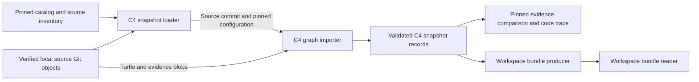

# Import schema 2 source graphs in C4 snapshots

## Product owner: vision

### Problem

Division maintainers need to follow a source repository's feature behaviour to the code and tests that support it, using the revision pinned by the division catalog. The published C4 importer rejects the schema 2 graph produced by the Ontology Kit, and an existing kit schema 1 graph also fails evidence role validation. The three bundled dummy repositories import successfully, so their usual demonstration misses both compatibility gaps. InternalOntology #185 needs the real importer to preserve and expose the pinned JEPA-Speech design records before its owner can complete B23. [InternalOntology #185](https://github.com/jamiemitchellconsultants/InternalOntology/issues/185) [ADR 0045](https://github.com/jamiemitchellconsultants/InternalOntology/blob/5df7c1f90ed2769c3926c58d19e79e0c03bc4e07/docs/adr/0045-require-a-compatible-division-importer.md)

### Users

- Division maintainers who build and validate catalogs with existing source repositories and need to consume their graphs through the same C4 snapshot.
- Source maintainers and reviewers who use design evidence to verify the relationship between a behaviour, an architecture decision and its implementation.
- The owner of InternalOntology #185, who needs to demonstrate that one imported JEPA-Speech behaviour leads to the same code recorded in the source graph.

### Outcomes and measures

1. **Current and existing graphs import.** The real loader imports standard kit schema 1 and 2 graphs and all three bundled dummy graphs. Measure with the existing representative catalog plus a standard kit schema 1 control and a synthetic schema 2 source. Unsupported schemas and invalid evidence remain explicit failures.
2. **The imported records match the catalog pin.** The imported design nodes retain their identity, labels, status and evidence. Their assertions retain their endpoints, relationships, basis and evidence. Measure by comparing those fields against the source Turtle, including a synthetic checkout whose current revision differs from the catalog pin.
3. **A reviewer can trace a behaviour to code.** Starting from the pinned JEPA-Speech B18 behaviour, a reviewer can follow the imported implementation assertion to the Submit symbol or through the runner component to its contained files and symbols. Measure with the existing B23 comparison in a disposable catalog after the synthetic import passes. [Pinned JEPA-Speech graph](https://github.com/jamiemitchellconsultants/JEPA-Speech/blob/3bcf7e7f5926e42231ae5dbfd9275f8166cc952c/docs/source-knowledge-graph/README.md)

### Scope

- Compatibility with schema versions 1 and 2 through the existing pinned C4 snapshot import.
- Evidence role eligibility using configuration at the pinned source revision, including the standard kit evidence roles and compatibility with the shipped dummy graphs.
- Preservation of the behaviour and decision records, their incident assertions and the evidence needed by B23, including replacement and successor relationships.
- Verification with the synthetic catalog and a disposable catalog pinned to the current JEPA-Speech trial graph.

### Out of scope

- Production division rollout or registration of JEPA-Speech in a production catalog.
- A new graph view, search interface, traversal API or change to the published catalog format.
- Changes to source repositories, the Ontology Kit schema or its graph checker.
- Model-assisted evidence or semantic review of claims.

### Research

- The published importer at be3973226d7c930e84975a7ab21485d776875606 loads the three representative dummy graphs. It rejects a kit schema 1 control on “evidence role selector mismatch” and both the synthetic and JEPA-Speech schema 2 inputs on “invalid graph schema version”. The Mac and network-disabled Node 24 Docker runs reproduced the same results. [Published graph loader](https://github.com/jamiemitchellconsultants/division-ontology/blob/be3973226d7c930e84975a7ab21485d776875606/src/c4/graph.mjs)
- The snapshot entry point already reads the source graph and configuration at the catalog-pinned source commit. The compatibility change can use that boundary, with a synthetic control that leaves the checkout on a different clean revision. [Pinned snapshot loader](https://github.com/jamiemitchellconsultants/division-ontology/blob/be3973226d7c930e84975a7ab21485d776875606/src/c4/snapshot.mjs)
- The existing B23 executable compares all design nodes and incident assertions with the source Turtle, including evidence records, and compares the reachable code for a named behaviour. The analysis can turn those checks and the importer controls into reviewable behaviours for this division feature. [B23 acceptance test](https://github.com/jamiemitchellconsultants/InternalOntology/blob/5df7c1f90ed2769c3926c58d19e79e0c03bc4e07/tests/design-links-division-acceptance.test.mjs)

## Analyst: behaviours

Behaviour references use the feature slug and a permanent id, for example c4-schema-2-source-graph-import#B1. Published ids stay assigned to their original behaviours.

### Outcome 1 — Current and existing graphs import

- **B1 — Import a standard kit schema 1 graph.** Given a catalog pins a valid standard Ontology Kit schema 1 graph with its configured evidence, when the existing C4 snapshot is loaded, then that source graph is available and its existing nodes, assertions, evidence and coverage are readable with the same identities and meanings as the source.

- **B2 — Keep the bundled graphs readable.** Given the representative catalog pins the three bundled schema 1 dummy repositories with the existing legacy evidence role IRIs, when the C4 snapshot is loaded, then Ecommerce, Warehouse and Accounting still import successfully, with the same recorded graph facts and evidence as before.

- **B3 — Import a standard kit schema 2 graph.** Given a catalog pins a valid standard Ontology Kit schema 2 graph containing a behaviour, a decision and evidence-backed links, when the C4 snapshot is loaded, then the graph is available and the design nodes and links can be read from that source's imported graph.

- **B4 — Reject unsupported or malformed graph versions.** Given a source graph is present at its catalog pin and has an unsupported version such as 0 or 3, a missing version, conflicting versions or multiple manifests, when its C4 snapshot is loaded, then it fails with a diagnostic identifying the invalid schema or manifest. Given a schema 1 manifest contains a schema 2 design kind, design status, node evidence or replacement or successor relationship, then loading rejects the graph with a schema version diagnostic.

- **B5 — Apply the evidence selector for the recorded role.** Given a schema 1 or 2 graph cites evidence with a standard kit role IRI for implementation, test, selected document, ontology or deployment, when the snapshot checks the citation, then it matches the path against the corresponding source configuration key at the catalog-pinned commit. For schema 1, each corresponding legacy role IRI without the role- prefix still resolves to its historical key. Schema 2 uses the standard kit role IRIs. A citation with an unsupported role, absent matching selector or wrong role for the path fails with an evidence-role diagnostic.

- **B6 — Keep the pinned evidence checks.** Given a citation points outside the source repository, references a missing or non-regular file, has the wrong blob id or an invalid line range, or cites a path outside covered scope, when the snapshot is loaded, then it fails on that evidence and provides no partial successful snapshot. A valid citation retains its path, role, blob id and inclusive line bounds.

- **B7 — Preserve unavailable sources.** Given the catalog pins a participating source whose graph is disabled or absent at that commit, when the snapshot is loaded, then the source remains in the catalog with an unavailable graph and the reason. The schema and evidence failure behaviours apply to present graphs.

### Outcome 2 — The imported records match the catalog pin

- **B8 — Use the catalog-pinned graph and configuration.** Given a catalog pins a source commit and the clean checkout is at a different revision where the selected-document path, declarations and selectors have changed, when the snapshot is loaded, then the imported facts and evidence come from the catalog-pinned commit and its configuration. A synthetic comparison pins the lite Widgets graph while its clean checkout is at the promoted full-mode revision.

- **B9 — Preserve the design node and assertion records.** Given valid schema 2 source Turtle declares behaviour and decision nodes and assertions incident on them, when the snapshot is loaded, then its imported node set matches the source by IRI, kind, label, design status and evidence references. Its incident assertions match by IRI, subject, object, relationship, basis and evidence references. Every reference resolves to its original imported evidence, and the ordinary source graph records and coverage remain available.

- **B10 — Reject invalid design records.** Given a schema 2 behaviour or decision has a missing, conflicting or unsupported status, a status for the wrong design kind, or missing, multiple, non-IRI, dangling or wrong-role node evidence, when the snapshot is loaded, then it fails with a diagnostic identifying the invalid design node or evidence. A valid behaviour status is current or retired. A valid decision status is proposed, accepted, superseded or deprecated. Each design node has one selected-document evidence reference. These two properties are reserved for behaviour and decision nodes.

- **B11 — Preserve retirement and succession links.** Given a schema 2 graph contains a retired behaviour with a recorded replacement or a superseded decision with a recorded successor, when the snapshot is loaded, then the original and successor nodes keep their distinct IRIs and statuses and the replacement or successor assertion keeps its recorded direction and evidence. The original implementation, decision and test links remain attached to the same nodes.

### Outcome 3 — A reviewer can trace a behaviour to code

- **B12 — Follow the direct and component-mediated traces.** Given the imported JEPA-Speech graph at 3bcf7e7f5926e42231ae5dbfd9275f8166cc952c and the reference zener-shape-tracing-motor-test#B18, when a reviewer follows incoming implementation assertions in the imported records, then one trace reaches Submit directly and another reaches MotorBlockRunner. Following the runner's outgoing containment assertions reaches its recorded files and symbols, including MotorBlockRunner.cs. The returned assertions, endpoints and evidence match the source at the pin.

- **B13 — Keep a trace grounded when links are absent.** Given an imported behaviour has no implementation assertion, or an implementing component has no recorded containment route to code, when a reviewer follows the imported records, then there is no code route for that branch of the walk. A matching name supplies no edge. The available records and recorded coverage are still visible.

### Uncertainties

| ID | Question | Decision or explicit deferral |
| --- | --- | --- |
| U1 | Which graph versions and role spellings must work? | Accept standard kit role IRIs for schemas 1 and 2. Accept the five corresponding legacy role IRIs in schema 1 for existing division graphs. Schema 2 requires the standard role IRIs. Unsupported versions are explicit errors. |
| U2 | What makes a design graph valid for import? | Validate the imported record shape, status and evidence, along with the existing graph evidence and reference checks. The producer's feature-document and ADR interpretation stays with the Ontology Kit checker. |
| U3 | How should the importer expose a status value or the evidence role name? | Preserve the source's meaning and stable identities. Field representation and integration with the existing API are deferred to the architect. The B23 comparison accepts the established role and status naming forms when they identify the same values. |
| U4 | Does B23 require a new view, traversal endpoint or production deployment? | Verify the walk through the existing imported records in the disposable catalog. New presentation, traversal interfaces and production onboarding are outside this feature. |
| U5 | What distinguishes the acceptance pin from the working checkout? | Deliberately leave the synthetic source checkout on the promoted revision after publishing its older catalog pin. The deployed case uses the existing checked JEPA-Speech graph commit. |

### Terms

Use the existing PublishedKnowledgeSnapshot term for the division baseline and the source-owned Ontology Kit terms for graph nodes, assertions, evidence, behaviour and decision records. Their IRIs and meanings already exist in the shared ontology or the upstream graph vocabulary. This feature introduces no shared ontology term.

## Architect: structure

### Components

| Component | Responsibility | Behaviours |
| --- | --- | --- |
| C4 snapshot loader, `src/c4/snapshot.mjs` | Keep the catalog and source inventory as the entry point. Verify each clean checkout, origin identity and available source commit. Read that source commit's graph configuration and pass the immutable commit and configuration to the graph importer. Return the existing snapshot shape. | B1–B8, B12 |
| C4 graph importer, `src/c4/graph.mjs` | Read the manifest version and apply its format and role rules. Validate graph structure and pinned evidence with the existing coverage checks. Return the validated source graph version and the nodes, assertions, evidence and coverage. Preserve the unavailable reason for optional missing or disabled graphs. | B1–B7, B9–B11 |
| Read-only Git access, `src/c4/git.mjs` | Resolve the catalog and source objects at explicit commits. Enforce checkout identity and safe repository-relative paths, and load regular file blobs from the pinned commit for the graph importer. | B6–B8 |
| Existing C4 snapshot records | Make the validated node and assertion maps available to current callers. Design nodes expose their status and evidence beside existing fields. The B23 comparison and reviewer walk use the same imported records to follow the actual incident assertions and containment links. | B9, B11–B13 |
| Workspace bundle producer and reader, `src/workspace/bundle.mjs` and `runtime/RuntimeKnowledge.Store/BundleReader.cs` | Pass the validated source graph version to the existing bundle manifest field. Admit valid schema 1 and 2 source graphs in the existing bundle format and retain null version metadata for unavailable graphs. | B1, B3, B7–B9 |
| Disposable acceptance harness | Use the real C4 snapshot with synthetic and JEPA-Speech catalogs. Compare the imported records with canonical Turtle and exercise malformed inputs in isolated fixtures. Use existing workspace bundle tests plus a mixed source-version fixture for the downstream metadata contract. | B1–B13 |

### Structure

The catalog commit selects the committed catalog and source manifest. Each catalog record selects the source commit. The snapshot loader uses the verified checkout as access to those Git objects. The same source commit supplies the configuration, graph Turtle and evidence blobs. The division catalog's format is independent of the source graph manifest's schema version.

The importer uses the existing Turtle parser and one validated manifest for each present graph. It reads the graph shape and version before returning records, matches each evidence role to the pinned selector key through the supported vocabulary, and validates the file, blob id, range and effective coverage. It resolves design node evidence and assertion references against the validated evidence map. Validation errors leave the C4 load unsuccessful. For a disabled or absent graph, the existing unavailable state carries the reason and empty collections. [ADR 0024](../../adr/0024-version-source-graph-validation-at-the-c4-boundary.md)

The available graph state exposes a numeric `schemaVersion` from the source graph manifest. The existing maps keep their expanded IRI keys. A behaviour or decision node adds `designStatus` as an expanded upstream IRI and `evidenceIris` as an array of evidence IRIs. The approved shape requires exactly one selected-document reference. Assertions keep their existing endpoints, relationship IRI, basis and evidence references. The evidence record's `role` remains the normalized selector key, so the standard and legacy spellings have the same interpretation in schema 1. Existing node kinds and assertion records keep their established fields. [ADR 0025](../../adr/0025-preserve-design-provenance-in-c4-snapshots.md)

The workspace bundle producer reads the version from the validated graph state and uses the existing `graphSchemaVersion` field. Its runtime reader accepts 1 or 2 for available graphs and null for unavailable graphs. The bundle envelope stays at version 1. The existing workspace projection and public request and response contracts continue to use their current fields. Complete design metadata is available in the C4 graph state and the raw pinned bundle files. [ADR 0026](../../adr/0026-record-the-actual-source-graph-version-in-workspace-bundles.md)

### Deployment and runtime

- The C4 loader runs on Node with locked repository dependencies and local Git objects. Catalog preparation and import run against verified, clean checkouts. The import uses committed inputs and the existing in-memory snapshot model.
- The local acceptance sequence uses the three bundled dummy repositories, the standard kit schema 1 control, and the synthetic schema 2 Widgets graph. Pin the Widgets catalog at the lite revision and leave the clean checkout at the promoted full-mode revision for B8. Use separate scratch cases for rejected versions, roles, evidence and design shapes.
- The deployed trial uses a disposable division catalog that pins JEPA-Speech at 3bcf7e7f5926e42231ae5dbfd9275f8166cc952c. Compare the source-owned records through the real loader before following B18 to Submit directly and through MotorBlockRunner to contained code. Capture the importer, catalog and source commit IDs. [InternalOntology B23 contract](https://github.com/jamiemitchellconsultants/InternalOntology/blob/5df7c1f90ed2769c3926c58d19e79e0c03bc4e07/docs/adr/0045-require-a-compatible-division-importer.md)
- Local acceptance can run in network-disabled Docker with the pinned repositories mounted read-only. Verify the workspace compatibility boundary with its existing bundle producer and runtime reader tests. If an existing installation adopts schema 2 source bundles, deploy the compatible reader before publishing such bundles. The disposable trial is the release evidence for this feature.
- Keep production source registration, catalog publishing, runtime activation and source-repository changes outside trial operations. The scratch catalogs and fixtures can be rebuilt from their recorded inputs.

### Traceability

| Behaviour | Components |
| --- | --- |
| B1 | C4 snapshot loader, graph importer, standard schema 1 fixture, workspace bundle producer and reader |
| B2 | C4 snapshot loader, graph importer, representative catalog and three bundled sources |
| B3 | C4 snapshot loader, graph importer, synthetic schema 2 fixture, workspace bundle producer and reader |
| B4 | C4 snapshot loader, graph importer, invalid manifest and version fixtures |
| B5 | Graph importer, C4 snapshot loader's pinned configuration, role selector fixtures |
| B6 | Graph importer, read-only Git access, pinned evidence and coverage controls |
| B7 | C4 snapshot loader, graph importer, workspace bundle producer and reader, unavailable source fixtures |
| B8 | C4 snapshot loader, read-only Git access, promoted Widgets checkout against the older catalog pin |
| B9 | Graph importer, existing C4 snapshot records, source comparison in the acceptance harness |
| B10 | Graph importer, malformed design record fixtures |
| B11 | Graph importer, existing C4 snapshot records, replacement and succession comparison |
| B12 | C4 snapshot loader, existing C4 snapshot records, pinned JEPA-Speech B23 comparison |
| B13 | Existing C4 snapshot records, missing-route controls in the acceptance harness |

### Decisions

- [ADR 0024](../../adr/0024-version-source-graph-validation-at-the-c4-boundary.md) puts format and evidence-role rules at the pinned C4 import boundary.
- [ADR 0025](../../adr/0025-preserve-design-provenance-in-c4-snapshots.md) preserves status and evidence as additions to the existing imported node records.
- [ADR 0026](../../adr/0026-record-the-actual-source-graph-version-in-workspace-bundles.md) carries the source graph version through existing workspace bundle metadata.
