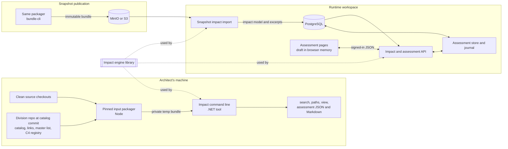

# Generalise impact assessment beyond C4: architecture

**Feature:** [#198](https://github.com/jamiemitchellconsultants/division-ontology/issues/198) · **Phase:** [#201, Architect structure](https://github.com/jamiemitchellconsultants/division-ontology/issues/201)

**Accepted by the user on 26 November 2026.** The phase completes when its pull request is reviewed and merged. This design serves the [accepted behaviours](02-behaviours.md) and the [product vision](01-vision.md). ADRs 0028 to 0034 record the decisions. ADR 0028 supersedes ADR 0001, the local C4 pilot.

**Amended** on 27 November 2026, in answer to the developer's pushback on #201 that followed the behaviours amendment (PR #213):
- traceability now covers B37, in place of the retired B4, and B38;
- `unlinked-term` is reported once for each source and term;
- `no-c4-mapping` applies only to a focus with no mapping at all;
- page metadata is read only for exported pages (ADR 0031, amended);
- the successor route needs the manage role.

The shape in one line: **Node verifies and packages, .NET assesses and renders.** The existing Node loaders keep checking checkouts, graphs, evidence and registries, and they package what they verified into the snapshot bundle. A single .NET impact engine reads that bundle. The command-line tool and the workspace both run it, so both produce the same output.

## Components

| Component | Responsibility | Behaviours |
| --- | --- | --- |
| **Pinned input packager** (Node: `src/c4/snapshot.mjs`, `graph.mjs`, `registry.mjs`, `git.mjs`, `src/workspace/bundle.mjs`) | Verifies checkouts, source graphs, evidence and C4 registries at their pinned commits, as today. Reads the relationship master list and the catalog's reviewed links at the catalog commit. Writes the verified facts into the bundle as two new file roles, `impactInput` and `relationshipMasterList`, next to the cited evidence bytes the bundle already holds. It makes no impact decisions. | B1, B37, B10, B11–B14, B24, B25, B32, Q3 |
| **Impact engine** (new `runtime/RuntimeKnowledge.Impact` library, with no database or network dependencies) | Builds an immutable **impact model** from a verified bundle. Runs candidate search, support rules, impact paths with master-list directions, reviewed-link crossings and C4 bindings, and C4 views. Raises every AssessmentGap. Validates, freezes and renders assessment records to Markdown. Extracts evidence excerpts and page metadata. It is the only implementation of these rules. | B1–B14, B17, B23, B25–B28, B30–B33, B35, B37, B38, Q3, Q4 |
| **Impact command line** (new `runtime/RuntimeKnowledge.Impact.Cli`, run through `npm run c4`) | Keeps today's commands, flags, output file names and safety checks. The Node front end parses the arguments and verifies the checkouts. It builds the bundle into a private temporary directory outside every repository, runs the .NET tool against it, and removes the bundle afterwards. The tool writes the output files. | B37, B5, B23, B24, B33 |
| **Snapshot impact import** (`RuntimeKnowledge.Worker` `BundleImport`, and replay) | When a candidate snapshot is projected, builds the impact model from the bundle with the engine. Stores the model, compressed, together with its evidence excerpts in `workspace_projection.impact_models`, in the same transaction as the rest of the candidate. Replay rebuilds it from the bundle. A bundle without `impactInput` has no model, and impact routes report `impactUnavailable` for it. | B15, B16, B25–B29, Q1, Q5, Q7 |
| **Impact and assessment API** (`RuntimeKnowledge.Api`, new `/api/impact/*` and `/api/assessments/*` routes) | Serves search, paths, C4 views, draft validation, preview and Markdown export to readers, and save and edit to managers. Every request names the snapshot it expects, and any other snapshot is refused with `snapshotChanged`. Keeps one impact model per process in memory, keyed by snapshot id. Pages search and saved-assessment lists with cursors. | B15–B22, B31, B33, B35, B36, Q1, Q2, Q7 |
| **Assessment store** (`RuntimeKnowledge.Store`: journal events, plus the `assessments` and `assessment_revisions` projections) | Appends `assessmentSaved` and `assessmentRevised` events, each carrying the frozen assessment and its rendered Markdown. Updates the current and revision views in the same transaction. Checks the active snapshot and the expected version inside that transaction. Replay copies frozen content verbatim. | B18–B22, B32–B35, Q5 |
| **Assessment pages** (`RuntimeKnowledge.Web`: new search, paths, draft, saved-list and saved-assessment pages) | Hold the draft in browser memory, bound to its snapshot. Render leads, step-by-step paths, evidence with excerpts and page metadata, and gaps. Offer Markdown export of a draft or a saved assessment. Show save and edit controls only to managers, and never show an approve or sign-off control. | B15–B22, B25–B28, B30, B31, B34–B36, B38, Q6 |
| **Publication guard** (catalog build tests and API contract tests) | Proves that no cited text reaches `dist/`, unauthenticated responses or the OpenAPI examples. The catalog builder itself is unchanged. | B29, Q7 |

## Structure

### Engine input: the impact section of the bundle

The bundle already holds the catalog, the source graph Turtle, the bytes of every cited evidence file, the C4 registry files and the published projection. This feature adds two file roles to the same manifest (schema version 1, because the change is additive):

- **`impactInput`** (`division-core`, `impact-input.json`): canonical JSON of what the Node loaders verified. It has, for each source: its id, commit, graph status and schema version; its nodes (IRI, kind, label, `denotes`, node evidence IRIs); its assertions; its evidence records (path, line range, blob id, role); and its coverage entries. It also has the verified C4 mappings and bindings and their gaps, the registry commit and digests, and the catalog's reviewed links (local term, shared term, kind). The engine never parses Turtle and never touches Git.
- **`relationshipMasterList`** (`division-core`, the master-list path from ADR 0032): the raw bytes of the list at the catalog commit, included only when the list exists.

The engine checks the manifest digest and each object's digest, as `BundleReader` does today, before building the model. The command line and the workspace build the model from byte-identical bundles for the same inputs, because `buildBundle` is deterministic.

### Impact model and rules

The model is built once for each bundle and is read-only. It holds:

- per-node adjacency lists, in both directions, for each relationship IRI;
- the term each node denotes, and each term's reviewed links;
- the C4 mappings and bindings;
- the master-list directions;
- the coverage entries;
- every evidence record, with its excerpt and its page metadata.

All ordering uses ordinal string comparison, as the Node code does today.

- **Support (B1, B2).** A node is supported when it has a C4 mapping, with the reason `Reviewed mapping`. Otherwise it is supported when verified evidence cites it: node-level evidence on a design record, or an assertion with evidence whose subject or object is the node. The reason names the distinct roles in sorted order. The Node loader refuses any graph whose evidence fails verification, so every loaded evidence record is verified. Catalog concepts stay unsupported.
- **Starts (B3).** Paths start from any supported lead. Any other start gives `unsupported-start`, with the new reason.
- **Steps (B6–B9).** From the current node, the engine collects candidate steps:
  - assertion steps, in the direction the master list gives each relationship (`subject-to-object`, `object-to-subject`, `both` or `none`);
  - a C4 binding step, as today (B14);
  - reviewed-link crossing steps.

  With no master list, every assertion is followed from subject to object, and the result carries one `no-relationship-master-list` gap. Relationships listed as `none` are counted for each relationship IRI and are not followed. An unlisted relationship produces one `unlisted-relationship` gap, with the nodes it was met at and a skip count. Candidate ordering, the visited-set rule and path ids stay as today. A path id is the SHA-256 of the steps serialised exactly as ECMAScript `JSON.stringify` does. This keeps the ids of today's C4 paths stable (B37).
- **Crossings (B11–B13).** For a node whose denoted term T has reviewed links, the engine finds each shared term S that T links to. A node that denotes S directly counts as linked `exact`.
  - If T's link to S is `exact`, the path crosses to every node in another source whose term links to S, whether `exact` or `specializes`.
  - If T's link is `specializes`, the path does not cross, and the result reports `specialization-boundary` for T and S.
  - A node on a path whose denoted term has no reviewed link adds that node to the result's single `unlinked-term` gap for that source and term. The gap lists the nodes in sorted order. A node that denotes no term adds nothing.

  A crossing is one step towards the depth limit, and it cites both links and the catalog commit. The engine never compares labels.
- **C4 views (B5).** These use today's projection rules, unchanged. A focus with no mapping at all is refused with `no-c4-mapping` and the node's identity. A focus mapped at a level other than the one the view needs keeps today's `unsupported-focus`.
- **Evidence display (B25–B28).** Each evidence record carries its cited lines, decoded as UTF-8 from the bundle blob. A blob that is missing or cannot be decoded gives `evidence-text-unavailable`. Page metadata comes from ADR 0031, and only for exported pages: cited files that open with a front-matter block. Code evidence and ordinary documents (B38) keep today's fields. Its excerpt is shown in the workspace pages but not written into Markdown, so the command line's Markdown keeps today's code-evidence shape.

### Assessment records, freezing and rendering

- **Record schema 2** replaces `architect` with `assessor`. It pins the snapshot id, the master-list identity (catalog commit and SHA-256, or `none`) and the C4 registry commit and digests. It can carry `startedFrom`, the id of an earlier saved assessment (B35). Schema 1 records are still read and rendered, so the C4 fixtures render as before (B37). Fields named `approved`, `approvalStatus` or anything with `signOff` in it are refused at the JSON boundary and by the engine (B31).
- **Freezing (B34).** Before an assessment is saved or rendered, the engine resolves the record against the model into a **frozen assessment**. That holds the record, the details of the confirmed and rejected leads, every cited path with its steps, every cited evidence record with its excerpt and page metadata, the snapshot's coverage gaps, the search and path gaps, and the unresolved gaps (B30). The Markdown is rendered from the frozen assessment alone, through one renderer with today's escaping, extended to page text (Q4). Page excerpts are written as indented, escaped lines, so injected markup stays inert.
- **Digest.** The assessment digest is the SHA-256 of the canonical frozen assessment, which keeps outputs deterministic (Q3).

### Workspace API surface

Every route sits under the existing authenticated `/api` group. Writes also need `Identity.ManagePolicy`. Each request body carries `snapshotId`. Errors use the fixed problem-details bodies from ADR 0018. The new codes are `snapshotChanged`, `impactUnavailable`, `invalidAssessment`, `approvalNotSupported` and `assessmentNotFound`, and `versionConflict` is reused.

| Route | Role | Purpose |
| --- | --- | --- |
| `POST /api/impact/search` | read | Leads for a description or an exact IRI. The page size is at most 100, with an opaque cursor binding the snapshot, a query digest and the last sort key (rank, source, IRI, kind). The cursor follows ADRs 0019 and 0020. |
| `POST /api/impact/paths` | read | Paths from one or more starts, at depth 1 to 6 (default 4), with gaps and the master-list identity. |
| `POST /api/impact/views` | read | A C4 view for a focus and level. |
| `POST /api/assessments/preview` | read | Validate and freeze a draft record. Returns the frozen assessment and its Markdown. Nothing is stored. |
| `POST /api/assessments` | manage | Save a draft record. Returns the id, version and link. |
| `PUT /api/assessments/{id}` | manage | Edit with `expectedVersion`, only while the assessment's snapshot is active. |
| `GET /api/assessments` | read | Saved assessments, newest first, at most 50 a page. The cursor is (saved time, id). |
| `GET /api/assessments/{id}` | read | The frozen content, the revision history and whether the assessment is pinned to an earlier snapshot. |
| `GET /api/assessments/{id}/markdown` | read | The stored Markdown bytes, as saved. |
| `POST /api/assessments/{id}/successor` | manage | A new draft record on the active snapshot, holding the same request id and description and `startedFrom`. Nothing is stored. |

`WorkspaceOpenApi` documents every route, and the build-time spec (ADR 0013) and its completeness checks (ADR 0016) cover them. The spec's examples use the synthetic fixture text only.

### Data stores

New migration `006_impact.sql`:

- **`workspace_projection.impact_models`** `(generation, snapshot_id, model bytea, model_sha256)`. The model is serialised with the engine's own canonical format and compressed. The API can read it. The publisher writes it during candidate projection. It is rebuildable from bundles (ADR 0008).
- **`workspace_projection.assessments`** `(generation, assessment_id, version, snapshot_id, request_id, author, saved_at, frozen jsonb, markdown bytea, started_from)`, with an index on `(generation, saved_at DESC, assessment_id)` for listing.
- **`workspace_projection.assessment_revisions`** `(generation, assessment_id, version, editor, edited_at, frozen jsonb, markdown bytea)`. It keeps every earlier version (B22).
- **Journal**: event types `assessmentSaved` and `assessmentRevised` in `workspace_journal.events`, each with the full frozen body and Markdown, appended in the same transaction as the projection rows (ADR 0005). The `workspace_api` role gets `INSERT` on the assessment tables and `SELECT` on `impact_models`.

## Deployment and runtime

- **Command line.** Architects need the .NET SDK pinned by `runtime/global.json`, as well as Node. `npm run c4 -- <command> …` keeps today's flags. The front end runs the tool with `dotnet run --project runtime/RuntimeKnowledge.Impact.Cli -c Release --no-launch-profile`, which builds it on first use. The temporary bundle goes under `os.tmpdir()`, outside every repository, with owner-only permissions, and it is deleted on exit. The output rules are unchanged: outside the repositories, no symlinks, no overwriting inputs.
- **Mac and home lab.** The API and Worker images reference the engine library. No new container or service is added. Migration 006 runs with the existing database bootstrap.
- **AWS.** The engine is included in the existing API and worker Lambda packages (`deploy/workspace/aws/package.sh`). The model cache lives for the life of a Lambda execution environment. A cold start reads and decompresses one model row. Q1 is measured on the reference container, and the developer records the cold-load time too. If the API Lambda's memory limit, or provisioned concurrency, needs to change to meet Q1, that is a Terraform change in `application.tf`, and the plan should record it.
- **Web.** The new pages ship in the existing Blazor static assets, on Caddy and on S3 with CloudFront.
- **Snapshot activation.** The model is written with the candidate projection. Activation stays a pointer change plus a journal record (ADR 0004), so an activated snapshot always has its model when its bundle has `impactInput`.
- **Old bundles.** A bundle built before this feature has no `impactInput`. Its snapshot still activates, and the impact routes return `impactUnavailable` until a new bundle is published.

## Traceability

| Id | Served by |
| --- | --- |
| B1 | Packager (verified evidence in `impactInput`); engine support rule |
| B2 | Engine support rule; concept leads unchanged |
| B3 | Engine path starts |
| B37 | Engine, with ids serialised as `JSON.stringify` does; a conformance corpus captured from today's Node outputs on the C4 fixtures before the Node engine is removed; schema 1 record rendering; the corpus comparison fails on any difference outside B37's list |
| B5 | Engine C4 views (`no-c4-mapping`) |
| B6 | Engine step rules; master list (ADR 0032) |
| B7 | Engine step rules (counts for `none`) |
| B8 | Engine step rules (`unlisted-relationship`) |
| B9 | Engine fallback rule (`no-relationship-master-list`) |
| B10 | Packager (master-list bytes); engine result and record pins (ADR 0032) |
| B11 | Packager (reviewed links); engine crossing rule |
| B12 | Engine crossing rule (`specialization-boundary`) |
| B13 | Engine crossing rule (`unlinked-term`), with no label comparison |
| B14 | Engine C4 binding step, unchanged |
| B15 | Search route with cursor; assessment pages; impact model in PostgreSQL |
| B16 | Paths route; assessment pages' step-by-step path display |
| B17 | Preview route; engine validation and freezing; draft in browser memory (ADR 0034) |
| B18 | Save route; assessment store (single transaction) (ADR 0033) |
| B19 | `ManagePolicy` on writes; browser draft and export kept |
| B20 | Read route; frozen content (ADR 0033) |
| B21 | List route with the (saved time, id) cursor |
| B22 | Edit route; `assessment_revisions`; `assessmentRevised` event |
| B23 | One engine and renderer (ADR 0028); byte-identical bundles from one packager (ADR 0029) |
| B24 | Impact command line through `npm run c4` |
| B25 | Engine excerpts; page metadata from front matter (ADR 0031); evidence held in the model (ADR 0030) |
| B26 | Page metadata reader, for exported pages only (`page-metadata-missing`) |
| B27 | Engine excerpt extraction (`evidence-text-unavailable`) |
| B28 | Engine evidence fields; assessment pages show code excerpts |
| B29 | Model and excerpts only behind authenticated `/api` (ADR 0030); publication guard |
| B30 | Engine freezing gathers snapshot, search, path and unresolved gaps |
| B31 | Engine and JSON boundary refuse approval fields (`approvalNotSupported`); no control in the pages |
| B32 | Record schema 2 pins; frozen assessment display |
| B33 | API snapshot check in the write transaction (`snapshotChanged`); command-line mismatch errors, as today |
| B34 | Frozen content and stored Markdown, copied verbatim on replay (ADR 0033) |
| B35 | Successor route, under `ManagePolicy`; `startedFrom` |
| B36 | `snapshotId` on every request; the page discards its draft on `snapshotChanged` (ADR 0034) |
| B38 | Engine evidence display: ordinary documents get no front-matter reading, no page-metadata gap and no Markdown excerpt; assessment pages show their cited lines |
| Q1 | In-memory impact model for each snapshot in each process; adjacency index; measured on the reference container, with the cold-load time recorded |
| Q2 | Authenticated `/api` group; `ManagePolicy` on save and edit; API tests for every route |
| Q3 | One engine; canonical serialisation; ordinal ordering; deterministic bundles |
| Q4 | One renderer escaping descriptions, reasons, labels and page excerpts; injection fixture |
| Q5 | Journal events with the frozen body and Markdown; single-transaction writes; replay copies verbatim |
| Q6 | Assessment pages built with native controls; axe and keyboard checks in `WorkspaceUiTests` and the browser verification scripts |
| Q7 | Publication guard over `dist/`, unauthenticated responses and OpenAPI examples |

## Decisions

- [ADR 0028: Run one .NET impact engine for the command line and the workspace](../../adr/0028-run-one-dotnet-impact-engine.md) (supersedes ADR 0001)
- [ADR 0029: Package verified impact input in the snapshot bundle](../../adr/0029-package-verified-impact-input-in-the-bundle.md)
- [ADR 0030: Hold evidence excerpts in a per-snapshot impact model behind sign-in](../../adr/0030-hold-evidence-excerpts-in-a-per-snapshot-impact-model.md)
- [ADR 0031: Read page title and address from YAML front matter](../../adr/0031-read-page-metadata-from-yaml-front-matter.md)
- [ADR 0032: Pin the relationship master list to the catalog commit](../../adr/0032-pin-the-relationship-master-list-to-the-catalog-commit.md)
- [ADR 0033: Freeze saved assessments in the journal with their Markdown](../../adr/0033-freeze-saved-assessments-in-the-journal.md)
- [ADR 0034: Keep assessment drafts in browser memory, bound to the snapshot](../../adr/0034-keep-assessment-drafts-in-browser-memory.md)

## Notes for the developer

- **Order of work.** First, capture today's Node outputs on the C4 fixtures as the conformance corpus. Then build the engine against that corpus. Only then remove `candidates.mjs`, `paths.mjs`, `project.mjs`, `render.mjs`, `assessment.mjs`, `feedback.mjs` and `code-evidence.mjs`. Feedback rendering and code supplements move to the engine with the rest.
- **Risk: path enumeration.** Path enumeration at depth 4 or more on 50,000 assertions can grow combinatorially. If the Q1 fixture shows that it cannot meet 5 seconds without bounding the paths returned, raise pushback to the analyst. Do not truncate silently.
- **Dependency on #205.** ADR 0032 fixes the master list's location and the minimum the engine reads from it. #205 owns everything else.
