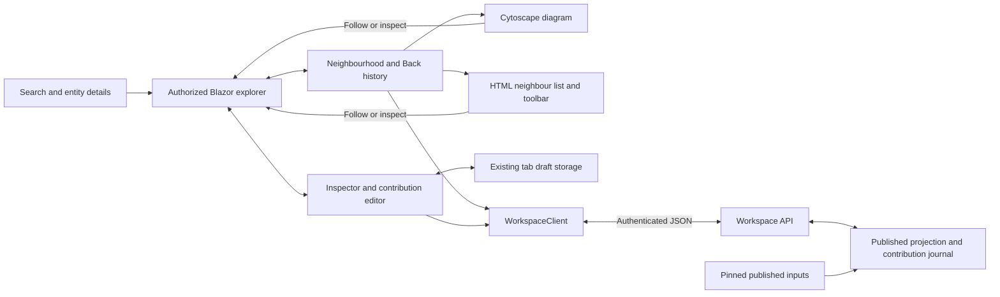

# Knowledge Graph Explorer — architecture

[Feature #145](https://github.com/jamiemitchellconsultants/division-ontology/issues/145) · [Architect Structure #148](https://github.com/jamiemitchellconsultants/division-ontology/issues/148)

**Accepted by the user on 21 November 2026.** The phase completes when its pull request is reviewed and merged. This design serves the [accepted behaviours](02-behaviours.md) and [product vision](01-vision.md). The architectural choices are recorded in ADRs 0021–0023.

## Components

| Component | Responsibility | Behaviours |
| --- | --- | --- |
| **Explorer page and navigation** | Provides an authorized `graph/{key}` entry from workspace search and entity detail. Owns the current focus, direction, selection, and in-page Back history. | B1–B6, B8–B10 |
| **Neighbourhood state** | Requests one-hop pages through `WorkspaceClient`, holds loaded nodes and relationships by stable identity, rejects superseded responses, and distinguishes continuation, empty, coverage, and stale states. | B1–B3, B5, B7–B10, B13 |
| **Diagram and neighbour list** | Render the same loaded neighbourhood and dispatch the same follow and inspect actions. The browser diagram draws directed edges and preserves positions and viewport. The native HTML list and toolbar provide keyboard navigation, inspection, paging, and zoom controls. | B1–B4, B6–B9 |
| **Inspector and contribution forms** | Load details on selection through `WorkspaceClient`, show evidence and history, and host the existing contribution editor and draft flows. | B6–B7, B11–B14 |
| **Workspace API, store, and journal** | Apply existing roles, serve traversal and details, validate and commit contributions, and retain history. Read the active published snapshot and store user changes only in the runtime workspace. | B1–B2, B6–B15 |

## Structure

### Navigation and identity

Use the existing `WorkspaceLinks` encoding for the entry route and accept concept and node keys. An entry link initializes an in-page exploration with direction **Both**. Following a neighbour commits a new focus when its first page loads and puts the previous successful view on the Back stack. A direction change queries page one for the same focus. The address identifies the entry for the exploration. In-page Back restores graph history, and browser navigation handles leaving the explorer. A failed navigation leaves the last successful frame available and allows retry of the attempted target. [Workspace link encoding](../../../runtime/RuntimeKnowledge.Web/Services/WorkspaceLinks.cs)

Use `PublishedKey` (`SourceId`, `Kind`, `Identifier`) for nodes. Use a published relationship key or an origin-tagged runtime contribution ID for edges. For a one-hop response, use each path’s single step and the provided entity context to populate both views, retaining the focus even when no edge is visible. Draw arrows from `From` to `To` even on an incoming traversal. Derive direction relative to the focus for list labels. Two edges with the same endpoints and label retain separate selection and detail actions. [Traversal contracts](../../../runtime/RuntimeKnowledge.Contracts/Published.cs)

Blazor owns selection and commands. A small same-origin JavaScript module receives display data and returns stable IDs for diagram gestures. Cytoscape.js uses preset positions with the focus at the centre and stable neighbour slots on expanding rings. Assign slots in traversal order and keep existing slots on append. Curved parallel edges give distinct hit targets, and the list always has a separate entry for each edge. Only the initial diagram for a new focus fits the view automatically. Append preserves pan, zoom, and selection. The list uses native controls with text for direction, source, and origin. It dispatches the same inspection and follow commands and stays usable if the diagram fails to initialise. [Cytoscape.js layout and edge documentation](https://js.cytoscape.org/) · [Blazor JavaScript interop](https://learn.microsoft.com/en-us/aspnet/core/blazor/javascript-interoperability/call-javascript-from-dotnet?view=aspnetcore-10.0)

### Paging and view consistency

- Page one calls `POST /api/traverse` through `WorkspaceClient` with the focus, selected direction, `maxDepth: 1`, and `includeUnavailable: false`. **Load more** sends the returned `nextCursor` with the same parameters. Append by stable identity and consume the next cursor even on an empty page. Track coverage gaps separately from completion. A completed view with zero visible edges and a view with an incomplete source get distinct status text. [Traversal operation](../../../runtime/openapi/workspace-api.json)
- A successful frame retains focus, direction, snapshot ID, loaded records, gaps, continuation, selection, positions, and viewport in browser memory. Back restores that frame until an observed change invalidates it. On `staleCursor`, clear the unusable continuation, mark affected frames stale and keep the current view visibly out of date until the reader chooses **Reload**. Treat an observed snapshot change or a successful workspace write as invalidation of older frames. On Back to an invalidated frame, reload its saved focus and direction from page one and explain the refresh. If the focus is unavailable, offer search or the last available view. Staleness discovery is based on existing API responses and writes in the current explorer session. [Cursor validation](../../../runtime/RuntimeKnowledge.Store/TraversalCursor.cs)
- Superseding a read advances its request identity. Apply completion only to the query and, for details, the selection that initiated it. Serialize continuation for a frame so each cursor is requested once at a time. Cancel superseded reads when possible, and use request identity to guard against late completion. A transient failure keeps the loaded frame and allows retry of the same read. An invalid cursor offers a fresh page one. A response claiming truncation without a continuation reports incomplete results and indicates that the supported paging contract is unavailable.

### Inspection and contribution boundary

Keep details in a panel within the explorer and load the selected entity or relationship through the existing detail operations. Reuse the workspace’s provenance and contribution displays. Preserve repository, pinned commit, path, line range, and blob where available. To support repository links, allow an optional public map of source IDs to trusted GitHub repository URLs in the existing web configuration. Form a commit-pinned evidence link only when the source has a configured URL and the evidence identifies its owning revision and path. Otherwise show the available citation and say that a link is unavailable. Repository access is checked by the destination when a user follows a link. History continues to use the existing workspace route. [Evidence display](../../../runtime/RuntimeKnowledge.Web/Components/OriginEvidence.razor) · [Source identity validation](../../../src/sources.mjs)

Use `WorkspaceClient.Session` to show manager controls and existing contribution commands to enforce authorization, active endpoints, relationship meaning, and versions on every write. Reuse `ContributionEditor`, `DraftState`, and `InventoryChoices`. Load endpoint and type choices on demand when editing starts. Keep the existing draft keys and restore through the same editor after sign-in. The graph can supply the existing sign-in flow a same-origin resume route with the current focus and the identity of the interrupted editor. Resume selection only after an authorized read, and keep draft text in the existing tab draft storage. Version conflict continues to require explicit review. [Contribution editor](../../../runtime/RuntimeKnowledge.Web/Components/ContributionEditor.razor) · [Draft state](../../../runtime/RuntimeKnowledge.Web/Services/DraftState.cs)

On a successful save, the explorer keeps the focus and direction, invalidates older frames, and reads page one again. For a saved relationship, the returned contribution ID provides a detail action even when that edge lies beyond the first page or is outside the selected direction. If the read after the save fails, retain the save confirmation and offer a retry of the read. The API commits contributions and history to the existing runtime store. The adoption and source Turtle files enter the system through published snapshots as read-only inputs. [Contribution result](../../../runtime/RuntimeKnowledge.Contracts/Contributions.cs) · [Workspace data boundary](../runtime-knowledge-workspace/03-architecture.md#contribution-journal)

## Deployment and runtime

- Publish the explorer with the existing `RuntimeKnowledge.Web` Blazor static assets. Include the pinned Cytoscape browser module and its license in `wwwroot` and load it on demand for the graph route. The Docker web image and the AWS packaging script both consume `dotnet publish` output. The same UI artifact can be served by Caddy on Mac and the home lab, and by the existing S3 and CloudFront hosting path on AWS. Verify the module is present in the package and served with a JavaScript content type. [Web image](../../../deploy/workspace/web/Dockerfile) · [AWS package script](../../../deploy/workspace/aws/package.sh)
- Deploy the UI with a workspace API release that includes the cursor contract from #119. The browser uses the existing OIDC and API configuration. The public evidence map is optional and uses the existing web configuration. The normal application release carries the explorer and its browser assets. [Workspace deployment](../runtime-knowledge-workspace/03-architecture.md#deployment-and-runtime) · [Cursor feature](../traversal-cursor-pagination/03-architecture.md)
- Extend the existing browser acceptance harness with the Order Fulfilment journey, explicit keyboard navigation, independently selectable parallel edges, and a busy node that continues past page one. Check stale refresh, recovery after delayed or failed reads, and manager saves with an independently signed-in reader. Use controlled responses for ordering, transient errors and an empty continuation page. Exercise the deployed API for paging and authorization and compare the pinned repository revisions and Turtle bytes before and after the contribution walkthrough. Verify that the published browser assets load on the graph route in the existing deployment checks. [Browser walkthrough](../../../deploy/workspace/verify-browser.mjs) · [Paging verification](../../../deploy/workspace/verify-traversal-paging.mjs)

## Traceability

| Behaviour | Component and mechanism |
| --- | --- |
| B1 | Explorer links resolve an available `PublishedKey`. Neighbourhood state and both renderers use source-qualified identity and labels. |
| B2 | The explorer follows a neighbour with a one-hop request. Direction controls filter requests, and diagrams use stored `From` and `To` endpoints. |
| B3 | Browser-memory frames retain loaded results and viewport, with refresh on known invalidation and a recovery route for missing focus. |
| B4 | Native neighbour list and toolbar expose the shared navigation, inspection, paging, and zoom commands. |
| B5 | Request identity and cancellation protect the current frame. Read-error controls surface retry and return. |
| B6 | Inspector calls workspace detail operations and presents pinned provenance while preserving the frame. |
| B7 | Origin-tagged edge identities support separate diagram and list actions. The inspector shows each origin, and history shows runtime changes. |
| B8 | Neighbourhood state follows `NextCursor`, appends by identity, and asks the diagram to preserve the viewport. |
| B9 | Neighbourhood state and toolbar present continuation, completed visible results, and published coverage independently. |
| B10 | Cursor errors from the API mark frames stale or retryable. Reload starts the original query at page one. |
| B11 | Inspector checks workspace session capability. Workspace API enforces the write role. |
| B12 | Existing editors and API commands create records. The save callback exposes the saved detail and refreshes the graph. |
| B13 | Store and journal preserve versions and history. The explorer invalidates earlier frames and reloads after its own saves. |
| B14 | Existing draft storage, error responses, and explicit version review keep rejected drafts available. |
| B15 | Workspace API writes runtime contributions and the journal. The browser acceptance walkthrough checks read-only repository inputs. |

## Decisions

- [ADR 0021 — Host the explorer in the existing workspace](../../adr/0021-host-the-explorer-in-the-existing-workspace.md)
- [ADR 0022 — Keep paged graph view state in the browser](../../adr/0022-keep-paged-graph-view-state-in-the-browser.md)
- [ADR 0023 — Render the graph with a local Cytoscape module and HTML controls](../../adr/0023-render-the-graph-with-a-local-cytoscape-module-and-html-controls.md)
