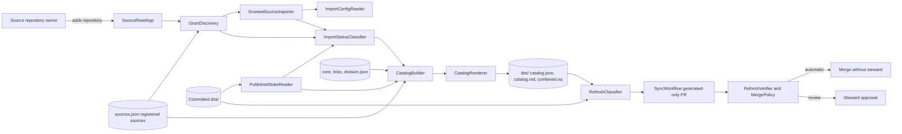

# One-action source onboarding — architecture

**Feature:** [#6](https://github.com/jamiemitchellconsultants/division-ontology/issues/6)

**Phase:** [#11 — Architect structure](https://github.com/jamiemitchellconsultants/division-ontology/issues/11)

**Status:** Draft for product-owner acceptance; pending review and merge of the architect phase pull request.

This design serves the [accepted behaviours](02-behaviours.md). It extends the existing scheduled catalog sync rather than adding a service. A source owner's one action is adding the repository to the division's read-only App. The next sync finds it, validates it, publishes its concepts with a visible status, and merges the refresh without a steward when only granted sources changed.

## Components

Components marked *new* are added; those marked *extended* exist today in `src/` or `.github/workflows/`.

| Component | Responsibility | Behaviours |
| --- | --- | --- |
| `SourceReadApp` (*new*, external) | The division's own GitHub App with Contents: read and Metadata: read only. Source owners add repositories to it. It is never installed on the division repository, so a grant can never write anywhere. One per division. | B1, B4, B5, B14 |
| `GrantDiscovery` (*new*) | Lists every repository in the source-read App's installation, reading the list to its last page, and records the installation's `repository_selection`. Excludes the division repository and every repository in `sources.json`. Pre-filters by asking whether `.division-ontology.json` exists on each default branch. Any error or short read fails the run; it never reports "no repositories". | B1, B4, B5, B13, B14 |
| `ImportConfigReader` (*new*) | Reads and validates `.division-ontology.json` from the cloned default-branch head: `schemaVersion`, `ontologyPath`, `namespace`, no unknown keys, size limit, same path and IRI rules as `sources.json`. Returns a configuration or a coded reason. | B1, B5, B9, B13 |
| `GrantedSourceImporter` (*new*) | For each configured repository, in source-id order, shallow-clones the default branch, takes its head commit, reads the configuration, then reads and parses the ontology blob through the existing `readSourceOntology` checks. Returns an outcome per source (`ok` with quads and commit, or a coded failure) and never lets one source's failure affect another. Infrastructure errors propagate and fail the run. | B6, B8, B9, B12, B15 |
| `PublishedStateReader` (*new*) | Reads the committed `dist/catalog.json` and `dist/combined.nq` and returns, per granted source, its published commit, namespace and named graph, plus the set of namespaces already held. This is the carry-forward input and the arbiter of namespace precedence. | B11, B14, B16, B17 |
| `ImportStatusClassifier` (*new*) | Combines discovery, importer outcome and published state into one status row per granted source: `current`, `invalid`, `not configured` or `access removed`, with commits and a coded, bounded reason. Rejects a namespace claimed by the core, a registered source or an earlier holder. Drops a never-published source that lost access. Sanitises reasons. | B10–B14, B16 |
| `CatalogBuilder` (*extended*: `buildCatalog`, `runCli`) | Builds from the core, registered sources (strict, as today), validated granted sources and carried-forward stale sources. Adds `origin` and `stale` to each source, orders everything deterministically, emits no timestamps, and rejects any link whose source is granted. A repository both registered and granted is one `registered` source. | B1, B3, B6, B11, B15, B16, B17 |
| `CatalogRenderer` (*extended*: `renderOutputs`) | Writes `importStatus` into `dist/catalog.json` and a status table into `dist/catalog.md`, so the App owner and readers see the same facts. | B10, B17 |
| `RefreshClassifier` (*extended*: `classifyRefresh`) | Compares only `registered` sources for the "source registration changed" reason. Treats granted sources, their graphs and status rows as automatic. Keeps the reviewed-link, linked-concept, core and non-`dist` checks unchanged. | B2, B3, B17 |
| `RefreshVerifier` and `MergePolicy` (*extended*: `verifyRefresh`, `evaluateMergePolicy`) | Rebuild from the base branch, now including the base `dist/` and live discovery, and require the candidate to match byte for byte. An automatic classification allows merge with no steward; a review classification or any change to `sources.json` or `division.json` still needs a current steward approval. | B2, B3 |
| `SyncWorkflow` (*extended*: `.github/workflows/sync-catalog.yml`, `merge-policy.yml`) | Mints a read-only token from the source-read App for discovery and source reads, and a separate writer token for the division repository as today. Runs discovery on the normal schedule and on dispatch. Opens the generated-only PR, or none when nothing changed. | B1, B6, B8, B14, B17 |
| `DivisionSetup` (*extended*: `scripts/init-division.mjs`, `docs/automation-setup.md`, onboarding guide) | Documents the two-App setup, the owner's single action and the `.division-ontology.json` format. Keeps the template with no sources, links or catalog entries. Retires the three-step instructions for first admission, leaving steward registration documented as the other path. | B3, B4, B7 |
| `FixtureDivision` (*new*, test-only) | An injectable grant provider and local Git repositories that stand in for GitHub in automated tests, plus a documented acceptance script for a real division copy with its own App. Used by B1–B17 tests and by the user phase. | B7, and every behaviour's automated check |

## Structure

**Data and ownership.**

- `.division-ontology.json` and the ontology belong to the source repository and are read, never written ([ADR 0010](../../adr/0010-declare-source-import-settings-in-a-dedicated-committed-file.md)).
- `sources.json`, `division.json`, `core/` and `links/` remain steward-governed and are unchanged by this feature. A grant never edits them (B1).
- `dist/` is the only place granted-source state is stored. Its status rows and carried-forward graphs are generated and reviewed like the rest of `dist/`, and are separate from authored files as AGENTS.md requires ([ADR 0011](../../adr/0011-publish-import-status-and-carry-forward-last-valid-version.md)).

**One sync, in order.**

1. `GrantDiscovery` lists the installation and drops registered sources and the division repository.
2. `GrantedSourceImporter` clones each configured repository's default branch and reads its configuration and ontology. A content failure becomes an outcome, and an infrastructure failure fails the run.
3. `ImportStatusClassifier` joins the outcomes with `PublishedStateReader`, assigns statuses, applies namespace precedence and decides what to carry forward.
4. `CatalogBuilder` builds the registered sources strictly, adds granted sources and carried-forward graphs, and `CatalogRenderer` writes `dist/`.
5. If `dist/` differs, `RefreshClassifier` labels the refresh `automatic` or `review`, and the sync opens or updates the single generated-only PR.

**Statuses and what the catalog holds**

| Situation | Status row | Concepts in catalog | Behaviour |
| --- | --- | --- | --- |
| Valid head | `current`, published = attempted | Head commit | B6, B8 |
| Invalid head (including a configuration later removed or broken), previously published | `invalid`, published = older commit, stale | Older commit, carried forward | B11 |
| Invalid head, never published | `invalid`, published none | None | B12 |
| Selected installation, repository never had configuration | `not configured` | None | B13 |
| Published, then access removed | `access removed`, stale | Older commit, carried forward | B14 |
| Never published, then access removed | no row | None | B14 |
| Namespace already held | `invalid`, `namespace-conflict` | None from the claimant | B16 |
| Nothing changed since the last published catalog | identical bytes | identical | B17 |
| Organisation-wide installation, no configuration | not listed | None | B5 |

## Deployment and runtime

- **No new service.** The work runs inside the existing `Sync division catalog` GitHub Actions workflow on its two-hourly schedule and on manual dispatch, using Node.js 20, Git and the repository's current dependencies. The merge-policy workflow reuses the same code to rebuild a candidate.
- **Credentials.** Each division creates two Apps ([ADR 0009](../../adr/0009-dedicated-source-read-app-with-polled-grant-discovery.md)). The source-read App (Contents: read, Metadata: read) is the one source owners add repositories to. Its client ID is stored in a new Actions variable and its private key in a new Actions secret. The existing `DIVISION_SYNC_APP_*` pair becomes the writer App, installed only on the division repository. The source-read token is passed to Git through the existing askpass script, never in a file, URL or command argument. Status reasons are sanitised before they reach `dist/`.
- **Division setup.** The template ships with no sources and no granted sources. `init-division` is unchanged in what it removes. A new division follows `docs/automation-setup.md` to create both Apps and sets the variables. Divisions that set up only the old single App keep working for registered sources; the sync stops with a configuration message rather than treating a missing source-read App as removed access if the committed catalog already holds a granted source.
- **Failure behaviour.** A discovery error, a rate limit, a clone failure or a short listing fails the run and leaves `dist/` untouched; the next scheduled run retries. A content problem in one source is reported in its status row, and all other sources publish in the same refresh.
- **Merge path.** An authored change (documentation, workflow, code) goes through its normal pull request. A generated-only refresh in which only granted sources and their status changed is classified `automatic` and can merge without a steward once the one-time automation setup is complete. Any change touching reviewed links, linked concepts, the core, `sources.json` or `division.json` waits for a current steward approval. If `DIVISION_AUTO_MERGE_READY` is unset, the refresh still opens as a PR and waits for the existing review rule.
- **Acceptance environment.** Automated tests use `FixtureDivision`. Behaviours B1, B4, B6 and B14 are accepted in a real division copy created with `init-division`, with its own App installed in an organisation that lets owners add it (U12).

## Traceability

| Behaviour | Components |
| --- | --- |
| B1 | `SourceReadApp`, `GrantDiscovery`, `ImportConfigReader`, `CatalogBuilder`, `SyncWorkflow` |
| B2 | `RefreshClassifier`, `RefreshVerifier` and `MergePolicy` |
| B3 | `CatalogBuilder`, `RefreshClassifier`, `RefreshVerifier` and `MergePolicy`, `DivisionSetup` |
| B4 | `SourceReadApp`, `GrantDiscovery`, `DivisionSetup` |
| B5 | `GrantDiscovery`, `ImportConfigReader` |
| B6 | `GrantedSourceImporter`, `CatalogBuilder`, `SyncWorkflow` |
| B7 | `DivisionSetup`, `FixtureDivision` |
| B8 | `GrantedSourceImporter`, `SyncWorkflow` |
| B9 | `ImportConfigReader`, `GrantedSourceImporter` |
| B10 | `ImportStatusClassifier`, `CatalogRenderer` |
| B11 | `PublishedStateReader`, `ImportStatusClassifier`, `CatalogBuilder` |
| B12 | `GrantedSourceImporter`, `ImportStatusClassifier` |
| B13 | `GrantDiscovery`, `ImportConfigReader`, `ImportStatusClassifier` |
| B14 | `GrantDiscovery`, `PublishedStateReader`, `ImportStatusClassifier` |
| B15 | `GrantedSourceImporter`, `CatalogBuilder` |
| B16 | `PublishedStateReader`, `ImportStatusClassifier`, `CatalogBuilder` |
| B17 | `CatalogRenderer`, `ImportStatusClassifier`, `RefreshClassifier` |

## Decisions

| ADR | Decision | Resolves |
| --- | --- | --- |
| [0009](../../adr/0009-dedicated-source-read-app-with-polled-grant-discovery.md) | A dedicated read-only source App per division; grants are found by polling the installation at normal sync | U11, B1, B4, B5, B14 |
| [0010](../../adr/0010-declare-source-import-settings-in-a-dedicated-committed-file.md) | `.division-ontology.json` at the source's default-branch root holds the ontology path and namespace | U10, B1, B9, B13 |
| [0011](../../adr/0011-publish-import-status-and-carry-forward-last-valid-version.md) | Status is generated into `dist/`; the committed `dist/` carries the last valid version forward; content failures become status, infrastructure failures fail the run | U3, U4, B10–B14, B17 |
| [0012](../../adr/0012-mark-source-origin-and-isolate-granted-source-failures.md) | Each source records its origin; granted-source failures are isolated; granted-only refreshes classify as automatic | U2, U7, U8, U14, B2, B3, B15, B16 |

## Assumptions and open points for the developer

- **Registered wins (U7) and the default branch head (U6)** are implemented as the Analyst stated them. This design adds no reason to change either.
- **Organisation policy (U12)** still has to be confirmed in the target organisation before B1 passes acceptance. Nothing here depends on it being true in the template.
- **`repository_selection`.** The developer must confirm how to read whether the installation is `all` or `selected` using the token-minting action already in the workflows. If it cannot be read, the fallback is to report a repository without configuration as `not configured` only after the importer has seen it listed, and to document that an organisation-wide installation will then list every unconfigured repository.
- **Contents API volume.** The pre-filter makes one request per installed repository per sync. The developer should confirm this stays within rate limits at the expected scale.
- **Consumers of `catalog.sources`.** The C4 snapshot loader and the workspace importer will see granted and stale sources, which they may not be able to clone at the recorded commit. The developer should check and handle `origin` and `stale` in each.
- **InternalOntology installer.** Offering to write `.division-ontology.json` is a change in that repository ([ADR 0010](../../adr/0010-declare-source-import-settings-in-a-dedicated-committed-file.md)). It is not needed for this repository's tests.
- **Deferred as agreed:** renamed, transferred or archived repositories (U13).
