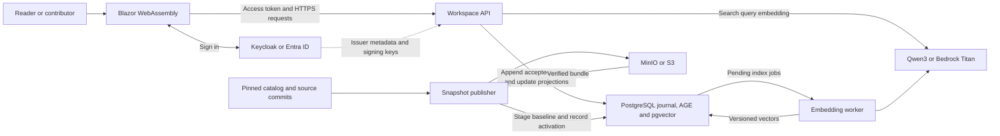

# Runtime knowledge workspace — architecture

**Feature:** [#25](https://github.com/jamiemitchellconsultants/division-ontology/issues/25)

**Phase:** [#28 — Architect structure](https://github.com/jamiemitchellconsultants/division-ontology/issues/28)

**Status:** Accepted by the user on 7 November 2026. Pending phase pull request review and merge. This design serves the [accepted behaviours](02-behaviours.md) and the [product vision](01-vision.md).

## Components

| Component | Responsibility |
| --- | --- |
| **Workspace UI** | Standalone Blazor WebAssembly app for inventory, entity and relationship details, semantic search, traversal, contributions and history. Shows source, snapshot and availability on results. Keeps unsaved input when a stale version or expired session prevents saving and prompts the user to review the current version or sign in again. |
| **Workspace API** | ASP.NET Core API for inventory, entity and relationship details, traversal, search, contribution commands, codification associations and history. Validates requests, applies the workspace role policy and returns stable identifiers, provenance and the snapshot used. The API owns the transaction boundary for saves. |
| **Identity integration** | Uses the deployment's configured OpenID Connect provider. The browser signs in with a public client using authorization code and PKCE. The API validates access tokens and maps provider claims to workspace roles and an issuer-qualified subject. |
| **Snapshot publisher** | Packages reviewed inputs at pinned Git commits, validates source identity, schema, checksums and evidence, then stages and activates a new baseline. A release or operator job invokes publication using its own service credentials. |
| **Artefact store** | Keeps immutable snapshot bundles, with a manifest of commit references and content digests. MinIO and S3 are selected through the same object-storage contract. |
| **Workspace journal** | A durable, append-only PostgreSQL schema. Contribution events are the authoritative record of user edits and associations. The same journal records successful snapshot activations so replay can reproduce which baseline was in effect. |
| **Workspace store** | Rebuildable PostgreSQL projections for current contributions, Apache AGE for graph traversal and pgvector for semantic search. The journal and the current contribution and traversal projections share one transaction boundary. |
| **Semantic discovery** | Generates and ranks embeddings over published descriptions and active annotations. A background job keeps vectors current. Search resolves matches through the workspace store and returns the source text and provenance. |
| **Acceptance workflow** | The pilot owner uses the workspace to gather context for a product definition. The wider-business reviewer explains the purpose and intended use in their own words, and the acceptance record captures the result. |

## Structure

### Published inputs and identities

Start with the division's `dist/catalog.json`, `dist/combined.nq` and source inventory at one division commit. The existing [C4 snapshot loader](../../../src/c4/snapshot.mjs) establishes the commit pinning and source verification pattern. Source graphs are optional artefacts at the catalog's recorded source commit. Discover them through the source's `ontology.config.json`, read Turtle with the [InternalOntology source graph contract](https://github.com/jamiemitchellconsultants/InternalOntology/blob/main/docs/features/source-knowledge-graph/05-user-guide.md), and carry forward the assertion's relationship IRI, direct or inferred basis, evidence path and lines, evidence blob and coverage. See the [C4 graph loader](../../../src/c4/graph.mjs) and [C# trial assertion](https://github.com/jamiemitchellconsultants/ontology-source-graph-csharp-trial-20261103/blob/3d0d06ad4e526c9bcc2053a3e43a0542b2e8f88e/docs/source-knowledge-graph/assertions/widgets.ttl).

Use the source identifier and source-owned IRI as the stable key within each published resource kind. Keep source commits and snapshot membership on revisions. Catalog concepts and graph nodes that denote them retain their respective identities and the explicit denotation link. Import the structured catalog inventory, including isolated concepts, relationship type definitions and their published constraints, and retain the original N-Quads in the bundle as inspectable source evidence. The traversal projection contains typed source graph assertions, reviewed catalog links, explicit denotation links and any validated C4 bindings as distinguishable record kinds. Unmapped RDF schema triples and free-text catalog fields remain source context. Source assertions use their assertion IRIs. Reviewed catalog links use the tuple of source, local IRI, shared IRI and relation kind because the catalog supplies no separate link ID.

C4 consumes the same pinned source graphs. Its reviewed mappings and bindings can supply versioned context and explicit cross-source references where applicable. Preserve both source identities and the cited support when showing a binding. Diagram generation and impact assessment remain in #7. An unavailable optional graph or incomplete coverage is represented as a gap. A present artefact with invalid content fails staging.

The first engineering inputs are the current division catalog and the ontologies of whichever sources the division registers, supplemented by the InternalOntology trials and the synthetic three-repository [C4 acceptance fixture](../c4-diagrams-from-source-knowledge-graphs/05-acceptance.md). The template registers no sources. The trials and fixture demonstrate graph import, coverage and cross-repository traversal in test data. The business acceptance dataset, owner, reviewer and search examples follow U12.

### Publication and workspace data

The publisher builds a manifest with the division commit, catalog digest, source commits, artefact digests, graph schema versions and any included C4 registry revision. It fetches source artefacts with read-only access, verifies evidence against the pinned commit and writes the verified bundle under an immutable object key. The import job records the bundle reference and stages its graph projection, inventory, provenance and baseline search data under the candidate snapshot ID. Publishing the same bundle again is safe.

One PostgreSQL transaction activates the validated snapshot by changing the active pointer and appending a snapshot activation record with the bundle reference. Staging and verification failures leave the previous pointer and contributions available. A read request uses one database view of the active snapshot and current contributions. Traversal, result provenance and search filtering use that same view. Snapshot activation and user changes share a committed order so replay can reconstruct which published revisions were visible and retain the last-known evidence for an endpoint.

### Contribution journal

Record successful annotation and relationship creations, edits and removals, and explicit codification associations as versioned events. Each event carries an event ID, committed journal position, event type and schema version, stable contribution ID and revision, validated acting principal, time, affected content and snapshot provenance. Relationship events preserve endpoint identities, direction and meaning. Capture enough before and after content to reproduce the change history and reconstruct the contribution independently of the current feeder graph. Allocate consecutive journal positions inside the write transaction so aborted writes leave no gaps. During a rebuild, apply each event once and use its ID and position to detect inconsistent replays. Snapshot activations are operational records and appear separately from user contribution history.

Commands check the supplied version where applicable and validate any new meaning as a published relationship type or the required custom label and explanation. An annotation's target and a relationship's endpoints must be available on creation. Replacing an endpoint requires the new endpoint to be available. Contributors can edit the content or remove a retained contribution with unavailable references. A contribution save and baseline activation serialize on the active snapshot record so newly supplied endpoints are validated against the snapshot in effect at commit. The transaction appends the event, updates the current SQL and AGE projections, and records any index work. The API acknowledges success after commit. Subsequent readers see the committed contribution, traversal and history through the writer database.

When a baseline loses an endpoint, the contribution stays inspectable with the stable identity and last-known provenance. Default traversal excludes runtime edges with unavailable endpoints. An explicit traversal option includes them with their availability marked. If that identity returns, its contributions resolve against the new snapshot. Soft removal hides a contribution from normal queries while keeping its history. A stale edit or removal returns the current version for review and leaves the user's draft available in the UI.

Codification is an explicit association between a runtime relationship ID and the selected published relationship ID. The association event stores its actor, time and the published provenance at association time. Query and history responses preserve each relationship and its origin, including when one becomes unavailable. Repository changes continue through the reviewed process outside the workspace.

### API and identity

Expose application operations over JSON and HTTPS. Inventory, detail, bounded directed traversal, search and history are read operations. Create, edit, remove and associate are contribution commands. For a published relationship type, validate any machine-readable endpoint constraints. Types without such constraints remain selectable with their source context. Traversal is parameterized by stable start IDs, direction, depth and availability. The backend owns the AGE queries. Responses carry pagination where appropriate, stable record IDs and provenance, and a version token for editable records. Version conflicts return a conflict response with the current record or its removal state. The UI leaves reconciliation and resubmission to the contributor.

Validate token signature, trusted issuer, intended API audience and lifetime on every protected request. Keycloak maps roles for the configured workspace client and Entra uses workspace app roles. Both adapters produce the same effective permissions. `ReadKnowledgeGraph` grants read, query and history. `ManageKnowledgeGraph` includes those operations plus contribution commands. Missing workspace roles grant no access. Record the validated issuer and stable subject for attribution. Business RBAC annotations are displayable context. External provider administrators own identities and assignments, and token revocation follows the provider contract. See the [OntologyService token validation precedent](https://github.com/jamiemitchellconsultants/OntologyService#authentication).

### Embeddings and search

Use PostgreSQL with **Apache AGE** for graph queries and **pgvector** for embedding storage and similarity search. The Docker database image includes both extensions in all three environments. The embedding adapter accepts text and returns vectors with the configured model identity and dimensions. Mac development uses Qwen3 Embedding 0.6B. The home lab uses Qwen3 Embedding 8B, Q4. AWS uses Titan Text Embeddings through Amazon Bedrock.

Generate baseline vectors during staging. For runtime edits, a worker consumes durable index jobs recorded by the contribution transaction and writes vectors tagged with the record version and embedding profile. Ranking uses the active profile and checks that matches belong to the selected snapshot and still refer to the current active record. A changed or removed annotation's old vector stops contributing results immediately. A fresh or edited annotation can be read and traversed as soon as it is saved, and becomes eligible for semantic matching when indexed. For an acceptance search that relies on a new annotation, verify that the current version has been indexed before testing retrieval. Record indexing delay separately. Report index lag or provider failure separately from an ordinary no-match result. Embedding failures leave graph browsing, traversal and contribution saves available.

Each deployment builds its own index. Record model version, dimensions and text-preparation profile. Build and activate a replacement index together with its matching query profile when those inputs change. Start with exact cosine search. The home-lab model's default 4,096 dimensions exceed the documented pgvector approximate index limits for `vector` and `halfvec`. Measure exact search and the model's fit alongside home-lab workloads before choosing any lower-dimensional or approximate approach. Search results support discovery and create no ontology assertions. [Qwen model dimensions](https://huggingface.co/Qwen/Qwen3-Embedding-8B) · [pgvector indexing](https://github.com/pgvector/pgvector#indexing)

## Deployment and runtime

| Environment | Application and workers | Identity | Data and embeddings |
| --- | --- | --- | --- |
| **Mac development** | Full Docker Compose setup with static Blazor hosting, API and worker. Seed local roles and load pinned demo artefacts. Supply images compatible with the Mac's architecture and keep database and object data in named volumes. | Local Keycloak with a development realm. Use a consistent issuer reachable from the browser and API container. | Docker PostgreSQL with AGE and pgvector, MinIO, and Qwen3 Embedding 0.6B served locally. |
| **Home lab** | Application repo supplies versioned images, Compose and configuration contracts. LocalAI resolves the application release and runs it behind shared Caddy. LocalAI owns host configuration, secrets and upgrades. | Shared Keycloak with workspace-specific client and roles. | PostgreSQL with AGE and pgvector and MinIO on persistent storage. A LocalAI-managed Qwen3 Embedding 8B Q4 endpoint supplies embeddings. |
| **AWS** | Terraform describes static Blazor hosting via S3 and CloudFront, the API via API Gateway and Lambda, and scheduled Lambda worker runs for bounded import and indexing batches. Large jobs can run the same worker as a separate container task if batch limits make Lambda unsuitable. | Entra ID app registration and role assignments managed separately from AWS Terraform. | Docker PostgreSQL with AGE and pgvector on a private EC2 host with a dedicated encrypted EBS data volume. Use private S3 for bundles and Bedrock Titan Text Embeddings. |

Select auth, object storage and embeddings through validated startup configuration. Deploy the same application version and database extensions across targets. A release runs schema migrations as an explicit job before the corresponding application version starts serving traffic. The API, publisher and index worker use separate service permissions. The publisher can stage and activate snapshots, the index worker can update search data, and the public API applies the two workspace roles to data operations.

On AWS, restrict database connectivity to the workloads that need it and bound Lambda database concurrency and connection counts. Provide the API with a path to the configured Entra metadata and signing keys. Use AWS-managed secrets, logs and metrics. Database availability depends on the proposed single host and its volume.

### Rebuild from the journal

Keep the journal schema on durable PostgreSQL storage across deployments and keep the snapshot bundles referenced by it available for replay. Feeder refreshes stage a new published projection while the contribution journal persists. Application migrations preserve the journal and the ability to read older event schema versions. Rebuild tooling writes derived state separately from the journal. Normal application roles may append accepted events but have no permission to update or delete prior journal entries.

To rebuild from scratch, start with the available journal and pinned bundles. Verify the sequence and bundle digests, then replay snapshot activations and successful contribution events in committed order into empty projections. Current authorization, timestamps, endpoint availability and business validation apply to new commands. Replay uses the recorded outcomes and original provenance, preserves unavailable endpoints and removals, and regenerates the search index from active content. Fail the rebuild on an unsupported event version, a gap or a missing required bundle. Before switching a live environment to rebuilt projections, pause writes, replay through the final committed position and verify the active snapshot, history and traversal.

Exercise a clean rebuild on Mac and the home lab, and in the AWS simulation. Compare the original and rebuilt active snapshot, contribution versions, removals, actor and endpoint provenance, codification associations and traversal results. Include a feeder refresh that changes the source revision of an endpoint, a later refresh that removes it, and one that restores the same source identity. Verify that replay through the removal shows the last published revision, even if there was no intervening contribution. Watch publication failures, active snapshot revision, pending index age and database readiness.

Backup and disaster recovery are outside #25. Backup storage, retention, recovery targets and procedures for loss of the journal or bundles are tracked in [follow-up #53](https://github.com/jamiemitchellconsultants/division-ontology/issues/53).

Verify the real Docker stack and its data and auth contracts locally and on the home lab. For AWS, run Terraform validation and mocked infrastructure tests, exercise the Lambda handler and adapter contracts with simulated services, and record the results as simulation. Live IAM, networking, Entra and Bedrock wiring and capacity on AWS require an account and separate verification. [Terraform provider mocks](https://developer.hashicorp.com/terraform/language/tests/mocking)

## Traceability

| Behaviour | Components and mechanism |
| --- | --- |
| B1 | Snapshot publisher, workspace store, API and UI list all inventory records, including isolated entities, with snapshot and coverage. |
| B2 | Semantic discovery, API and UI return ranked active matches with provenance and an explicit no-match result. |
| B3 | Workspace store, API and UI preserve source IDs and resource IRIs through search, detail and traversal. |
| B4 | Snapshot publisher, artefact store, workspace journal and workspace store stage verified bundles and record activation atomically. |
| B5 | Workspace store, API and UI resolve stable IDs against the active baseline and retain last-known provenance. |
| B6 | Workspace store, API and UI apply the unavailable-endpoint option and label returned unavailable records. |
| B7 | Workspace API, store and UI validate, persist and retrieve typed and attributed annotations. |
| B8 | Workspace store, API and UI include active annotation context in traversal results. |
| B9 | Identity integration and API apply the manage role regardless of original author. The store records the acting principal. |
| B10 | Workspace API and journal keep stable IDs and append versioned changes. The store excludes removed records from normal results. |
| B11 | Workspace API, store and UI enforce version checks and preserve the unsaved draft through conflict review. |
| B12 | Workspace store, API and UI return business RBAC annotations as context. Identity integration governs access separately. |
| B13 | Semantic discovery, API and UI surface published meaning, annotations and provenance for the pilot owner. |
| B14 | Acceptance workflow captures the nominated reviewer's explanation and outcome using the owner's definition. |
| B15 | Identity integration and API support configured Keycloak and Entra issuers through the same policy. |
| B16 | Identity integration and API apply reader and contributor capabilities, including history and association. |
| B17 | Identity integration and API reject invalid tokens and missing workspace roles before touching data. |
| B18 | API evaluates each token and UI preserves pending input for reauthentication. |
| B19 | Workspace API and store save both available identities, direction, meaning and source provenance. |
| B20 | Workspace UI and API offer an applicable published type or custom meaning and store the explicit choice. |
| B21 | Workspace API and store validate against the serialized active snapshot and commit only valid complete changes. |
| B22 | Workspace journal and store commit the event and traversal projection atomically. The API reads the committed state. |
| B23 | Workspace journal, API and UI expose attributed before and after history and evidence under the workspace roles. |
| B24 | Workspace UI, API, journal and store record explicit codification associations and expose both provenances. |
| B25 | Workspace store, API and UI keep each relationship separately identifiable and apply availability and removal rules. |

## Decisions

- [ADR 0004 — Import and activate pinned knowledge snapshots](../../adr/0004-import-and-activate-pinned-knowledge-snapshots.md)
- [ADR 0005 — Keep graph, contribution history and vectors in PostgreSQL](../../adr/0005-keep-graph-history-and-vectors-in-postgresql.md)
- [ADR 0006 — Configure identity and embeddings by environment](../../adr/0006-configure-identity-and-embeddings-by-environment.md)
- [ADR 0007 — Deploy the workspace on Mac, home lab and AWS](../../adr/0007-deploy-workspace-on-mac-home-lab-and-aws.md)
- [ADR 0008 — Rebuild the workspace from snapshots and contribution events](../../adr/0008-rebuild-workspace-from-snapshots-and-events.md)
