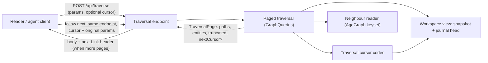

# Traversal cursor pagination — architecture

**Feature:** [#119](https://github.com/jamiemitchellconsultants/division-ontology/issues/119)

**Phase:** [#122 — Architect structure](https://github.com/jamiemitchellconsultants/division-ontology/issues/122)

**Status:** Accepted by the user on 21 November 2026; pending review and merge of the architect phase pull request.

**Basis:** [Accepted vision](01-vision.md), [accepted behaviours](02-behaviours.md) (as amended by PR #130), the analyst and architect handoffs on #119, and ADR [0019](../../adr/0019-carry-the-traversal-frontier-in-the-cursor.md) and [0020](../../adr/0020-bind-traversal-cursors-to-snapshot-and-journal.md).

## Components

### Traversal contract (RuntimeKnowledge.Contracts)

`TraversalRequest` gains an optional cursor field (absent on a first-page request); `TraversalResult` gains a nullable `nextCursor` (present exactly when another page exists). No other contract shape changes, so first-page clients see today's response plus the additive field (B5). Serves: B1–B15 (the shapes those behaviours speak about).

### Paged traversal (RuntimeKnowledge.Store — GraphQueries)

The breadth-first walk becomes page-bounded. It starts from a first-page request or from a validated cursor, emits at most 100 paths, and — when the walk is unfinished — encodes the resumption state as the next cursor instead of discarding the frontier as today. Each page resolves only its own paths' endpoints into entity context (labels, provenance, availability, annotations), preserving today's published-before-runtime step order within each node expansion and the global breadth-first order across the page boundary. A per-request examined-row budget (1000 rows) is enforced at fetch time from the remaining allowance and bounds the neighbour rows examined to fill a page; exhausting it ends the page early — possibly with zero paths — with a cursor whose resume position already points past every processed row, never a scan without limit and never a re-examined row. (Amended after developer-plan pushback.) Serves: B1–B7, B12, B16–B18.

### Traversal cursor codec (RuntimeKnowledge.Store)

Encodes and decodes the cursor payload of ADR 0019/0020: version, bound parameters, snapshot id, workspace journal position, pending frontier (edge-reference chains), and the current node's per-scope keyset resume positions. Decoding validates in ADR 0020's order — shape, then parameter match, then snapshot/journal freshness — raising `invalidCursor` (422) or `staleCursor` (409) as `WorkspaceException`s with the restart instruction. Serves: B8–B12.

### Neighbour reader (RuntimeKnowledge.Store — AgeGraph)

Nearly unchanged: its keyset read (`r.key > after`, ordered, per node and scope) gains a validated fetch limit so each batch is capped at the page's remaining examined allowance (at most 101) — that, plus counting every returned row, is what makes mid-node resumption and the examined counting of B16/B17 enforceable rather than approximate. The paged traversal supplies the resume positions (last processed key, emitted or filtered) from the cursor. (Amended after developer-plan pushback.) Serves: B2, B12, B16, B17.

### Workspace view (RuntimeKnowledge.Store — projection state and journal)

The request's existing `RepeatableRead` transaction reads the projection state (active snapshot) and the workspace journal head in the same view the walk resolves against, so cursor validation and resumption cannot disagree about which view they are on. Contribution writes already append to the journal, which is what makes any-edit invalidation a single head comparison. Serves: B10, B11, B12.

### Traversal endpoint (RuntimeKnowledge.Api — workspace routes)

Passes the cursor through to the paged traversal, declares the `invalidCursor` and `staleCursor` error codes for the operation (the spec derives 422/409 from the existing `ProblemResponses.StatusFor`; no new codes, no changes to existing endpoints), and adds the runtime `next` `Link` header — the workspace HTTPS link relation mapped to `traverseGraph` — whenever the response carries a `nextCursor`, omitting it on the final page. Serves: B8–B11 (as declared errors), B13, B15.

### API description (RuntimeKnowledge.Api — OpenAPI generation)

The generated spec documents the cursor request field, `nextCursor` response field, the operation's cursor errors, named first-page and next-page request examples, and the success-response links `next` → `traverseGraph` alongside the existing `entityDetail` and `relationshipDetail` links. The committed spec is regenerated by building the API and must match the generated output. Serves: B14 (and B13/B15's discoverability).

### Verification harnesses (RuntimeKnowledge.Tests, scenario fixtures)

The OpenAPI test category pins the contract surface of B14 against the served and committed spec. The Postgres-backed scenario adds: a busy node (>100 published paths plus a workspace-authored path beyond page one), the multi-hop branch-boundary fixture, final-page assertions, cursor behaviour after snapshot activation and after a workspace edit, and the examined-step counting measures of B16/B17 — counted by observing neighbour rows returned per request in the test harness, with no production telemetry added. `SpecCompleteness` gains the traversal cursor errors as declared operation errors. Serves: B1–B3, B5, B6, B10, B11, B14–B17 as verified behaviour.

## Structure

A first-page request carries no cursor: the walk starts fresh and the first page is byte-compatible with today's cap behaviour (B5). A continued request is validated by the codec against the parameters and the transaction's current snapshot and journal head before any neighbour is read; only then does the walk rebuild its queue from the cursor's frontier — re-deriving each pending path's steps and visited set from its edge references — and resume, starting with the partially expanded node at its saved keyset positions. The server keeps nothing between requests (ADR 0019).

## Deployment and runtime

No new components, tables, migrations, or background jobs. The change is confined to the Contracts, Store, and Api projects and their tests; the API's Lambda/API Gateway deployment, the Blazor UI (out of scope), and the read-only `RepeatableRead` transaction pattern are unchanged. Traversal remains a read operation: no journal appends, no projection writes, and no Turtle file in any repository is read or written by this feature. Cursor size is bounded by ADR 0019 as amended: dictionary-coded, deflate-compressed payloads, a 262144-character cap on the compressed form asserted again at issue time so no server-issued cursor is undecodable, and an 8388608-byte decompressed guard; over-cap or otherwise unresolvable payloads are `invalidCursor`.

## Traceability

| Behaviour | Served by |
| --- | --- |
| B1 — Continue a busy one-hop traversal | Paged traversal; Traversal contract; Neighbour reader |
| B2 — Multi-hop across a branch boundary | Paged traversal; Traversal cursor codec; Neighbour reader |
| B3 — Directions and unavailable endpoints | Paged traversal; Workspace view |
| B4 — Path order preserved | Paged traversal; Neighbour reader |
| B5 — First page compatibility | Traversal contract; Paged traversal |
| B6 — `truncated` semantics | Traversal contract; Paged traversal; Traversal endpoint |
| B7 — Entity context per page | Paged traversal |
| B8 — Parameter-bound cursor | Traversal cursor codec; Traversal endpoint |
| B9 — Malformed cursor | Traversal cursor codec; Traversal endpoint |
| B10 — Snapshot refresh staleness | Traversal cursor codec; Workspace view |
| B11 — Any-edit invalidation | Traversal cursor codec; Workspace view (journal head) |
| B12 — Exact-once continuation | Paged traversal; Traversal cursor codec; Neighbour reader |
| B13 — `next` link | Traversal endpoint; Traversal contract |
| B14 — Spec documents paging | API description; Traversal endpoint (declared errors) |
| B15 — Following the link | Traversal endpoint; Paged traversal; Traversal cursor codec |
| B16 — No replay of earlier pages | Paged traversal; Neighbour reader; Verification harnesses (counting) |
| B17 — Bounded filtering work | Paged traversal (examined-step budget); Neighbour reader; Verification harnesses (counting) |
| B18 — Read-only | Paged traversal; Workspace view (read transaction only) |

## Decisions

- [ADR 0019 — Carry the traversal frontier in the cursor](../../adr/0019-carry-the-traversal-frontier-in-the-cursor.md): stateless resumption, compact edge-reference frontier, examined-step budget. (User decision: cursor-carried over server-retained state.)
- [ADR 0020 — Bind traversal cursors to the snapshot and the workspace journal position](../../adr/0020-bind-traversal-cursors-to-snapshot-and-journal.md): binding contents, validation order, error reuse at existing statuses, unsigned-cursor stance.
