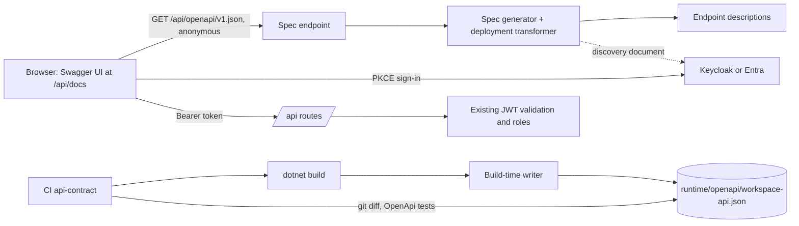

# Workspace API OpenAPI docs

**Feature:** [#105](https://github.com/jamiemitchellconsultants/division-ontology/issues/105) (lite mode)

## Product owner — vision

**Status:** Accepted by the product owner on 19 November 2026. Amended on 19 November 2026 after analyst pushback.

### Problem

A division that deploys the runtime knowledge workspace gets a JSON API under `/api`, but nothing describes that API except its C# routes and contract types. Developers who want another division system, agent or tool to read the knowledge graph have to read the source to learn which endpoints exist, what they accept and return, and which role each one needs. The people maintaining this template and its division copies have the same problem when they test or debug the API, and reviewers cannot see from a pull request whether the API contract has changed. Both groups need an accurate description of the API that is always up to date, plus a page where they can browse it and try calls against a running deployment with their own access rights.

### Users

- **Integrating developer:** builds or connects another division system, agent or tool (for example a future MCP server) that reads from, or contributes to, a deployed workspace. Needs the contract without reading this repository's code.
- **Workspace developer:** maintains this template or a division copy of it. Needs to explore, test and debug the API against local, home-lab and AWS deployments.
- **Contract reviewer:** a code owner or steward reviewing a pull request. Needs to see when the API contract changes, and how.

The existing roles still decide what anyone can do through the API. A signed-in user with `ReadKnowledgeGraph` can call the read operations. A user with `ManageKnowledgeGraph` can also call the contribution commands.

### Outcomes and measures

1. **Integrators can learn the API without reading code.** Measure: every operation mapped by the API, plus the health check, appears in the generated spec. Each one has its request and response shapes, the role it needs, and its error responses. An automated check compares the API's mapped routes with the spec and fails on any gap.
2. **Contract changes are visible in review.** Measure: the spec is written when the app builds and committed to the repository. CI fails when the committed spec differs from the one the code generates. A pull request that changes a route or contract type without updating the spec cannot pass.
3. **Developers can try the API against a live deployment.** Measure: from the docs UI, a user signs in through that deployment's identity provider (Keycloak or Entra) and calls the API with their own roles. A reader gets a successful response from a read operation. A contributor can run a contribution command. A user without the needed role sees the API's refusal. This walkthrough passes in the local, home-lab and AWS deployments.
4. **It works wherever the workspace is deployed.** Measure: the spec and docs UI are available at one documented path in the local compose, home-lab and AWS deployments. A division copy created from the template gets them with no extra per-division code.
5. **Publishing the docs does not widen access to data.** Measure: anyone who can reach the deployment can fetch the spec and open the docs UI without signing in. Every call that returns or changes knowledge-graph data still needs a valid token with the right role. An anonymous data request is refused, just as it is today.

### Scope

- An OpenAPI description of the workspace API, generated from the code, covering every read operation, contribution command and the health check.
- The spec served by the running API, and also written as a file when the app builds, committed to the repository and kept up to date by a CI check.
- A Swagger-style docs UI served with the deployed workspace, showing the generated spec.
- Signing in from the docs UI through the deployment's configured identity provider, and calling the API with the signed-in user's roles.
- Open, unauthenticated access to the spec and docs UI in every deployment. The API's shape is not treated as secret.
- Making the local, home-lab and AWS deployments, and the template that division copies inherit, serve the spec and docs UI.
- Describing what the API already does. Adding descriptions, examples and response metadata to existing endpoints is in scope. Changing endpoint behaviour is not, with one exception: the API's 400, 401 and 403 responses become problem-details responses carrying a `code`, like its other errors, so that every error an integrator receives has the same documented shape. Which requests receive which status does not change, and a 401 never says why a token was rejected.

### Out of scope

- An MCP server, SPARQL endpoint or any other new query interface over the knowledge graph.
- Setting up identities for other systems to call the API without a person signing in, such as service clients. The spec describes the authentication the API already accepts; giving other systems a way to get tokens is a separate feature.
- Generated client libraries or SDKs.
- An API versioning or deprecation policy.
- New endpoints, or changes to the behaviour, paths or payloads of existing ones, other than the 400, 401 and 403 response bodies named in Scope.
- A switch to hide the spec or docs UI in particular deployments.
- A separate public developer portal, or publishing the spec outside the deployment and the repository.
- Changes to the workspace's Blazor web UI.

### Research

- **Generating the spec while the app builds.** The API targets .NET 10 (`runtime/global.json`, `RuntimeKnowledge.Api.csproj`). In current ASP.NET Core, `Microsoft.AspNetCore.OpenApi` generates the spec while the app runs, and adding `Microsoft.Extensions.ApiDescription.Server` also writes it to a file during the build. The build starts the app's entry point with an inert server to do this. The output folder can be set with an MSBuild property, and one app can produce several documents. The package version should match the framework. Sources: [Microsoft Learn — Generate OpenAPI documents](https://learn.microsoft.com/en-us/aspnet/core/fundamentals/openapi/aspnetcore-openapi), [Microsoft Learn — Using OpenAPI documents](https://learn.microsoft.com/en-us/aspnet/core/fundamentals/openapi/using-openapi-documents), [Meziantou — Generate OpenAPI specification at build time](https://meziantou.net/generate-openapi-specification-at-build-time-from-the-code-in-asp-net-core.htm), [Scalar — Build-time generation](https://scalar.com/products/api-references/integrations/aspnetcore/build-time-generation).
  - *Implication:* the API's startup currently resolves database and identity settings, and fails without them. Generating the spec during a build or in CI needs startup to tolerate having no real settings. The architect should resolve this.
- **Signing in from a Swagger-style UI.** Swagger UI supports the authorization code flow with PKCE (`usePkceWithAuthorizationCodeGrant`) using a public client with no secret. Keycloak supports this for public clients. Entra examples exist from the community but not in Microsoft's own documentation. Known problems: Swagger UI's dialog may still ask for a client secret, which can be left empty, and the PKCE setting must match the identity provider's client. Scalar, a newer Swagger-style UI with an ASP.NET Core integration, also supports the authorization code flow with PKCE, extra authorization parameters such as an audience, and settings read from configuration. Either UI needs the spec to declare an OAuth2 security scheme. Sources: [Swagger UI — OAuth2 configuration](https://swagger.io/docs/open-source-tools/swagger-ui/usage/oauth2), [Duende — Swagger authentication in .NET 10 with OAuth 2.0 and PKCE](https://duendesoftware.com/blog/20251126-securing-openapi-and-swagger-ui-with-oauth-in-dotnet-10), [Milan Jovanović — Keycloak with ASP.NET Core](https://milanjovanovic.tech/blog/integrate-keycloak-with-aspnetcore-using-oauth-2.md), [Scalar — ASP.NET Core integration](https://guides.scalar.com/scalar/scalar-api-references/integrations/net-aspnet-core), [swagger-ui issue #7438](https://github.com/swagger-api/swagger-ui/issues/7438).
  - *Implication:* each deployment's identity provider must allow the docs UI's sign-in callback address, alongside the web UI's existing one. The realms in `deploy/workspace/local` and `deploy/workspace/home-lab` currently allow only the web UI's address.
- **Does public documentation reveal anything sensitive?** The spec would show the shape of the routes and contract types, the required roles, and the identity provider's issuer and client ID. The issuer and client ID are already public: the web UI loads them from its `appsettings.json`. The API already refuses data requests without a valid token and role (`runtime/RuntimeKnowledge.Api/Identity.cs`), and the docs UI adds no other way in. Examples in the spec must use invented values, never real catalogue content, because the catalogue is private (see the README). Source: this repository.
- **Routing in each deployment.** Only `/api/*` reaches the API today. In AWS, API Gateway routes `ANY /api/{proxy+}` (`deploy/workspace/aws/application.tf`) and CloudFront forwards `/api/*` (`deploy/workspace/aws/cdn.tf`). Locally, Caddy proxies `/api/*` and serves everything else as the web app (`deploy/workspace/local/Caddyfile`). The spec and docs UI need either a path under `/api` or new routes in all three deployments. The architect should decide which. Source: this repository.

- **Error responses today.** Errors raised by the workspace (404, 409, 422 and 503) are already problem-details responses with a `code`. A 401 (sent with `WWW-Authenticate: Bearer`), a 403, and the 400 returned when a request body or parameter cannot be read, all have empty bodies. Source: a run of the API, recorded in the developer's pushback on [#105](https://github.com/jamiemitchellconsultants/division-ontology/issues/105).
  - *Implication:* without the one behaviour change in Scope, the spec could not describe every error in the same shape.

## Analyst — behaviours

**Status:** Accepted by the user on 19 November 2026. Amended on 19 November 2026 after developer pushback: B2, B3, B12, B13 and B19 are regenerated, B22 is new, U6 is revised, and U15 and U16 are new.

**Basis:** the accepted product-owner vision above, the product-owner handoff on #105, and the analyst decisions recorded with the user. The outcome numbers match the vision. The scenarios describe observable behaviour. Components, products, paths and deployment details are left to the architect.

### Behaviours

#### Outcome 1 — Integrators can learn the API without reading code

- **B1 — Every operation is described.** **Given** the operations the workspace API maps, **when** the spec is generated, **then** each read operation, each contribution command and the health check appears with its method, path, summary, parameters (including `cursor` and `limit` where it pages), request schema, success response schema and required role. The required role is `ReadKnowledgeGraph` for read operations, `ManageKnowledgeGraph` for contribution commands, and none for the health check.
- **B2 — Every error response is described.** **Given** an operation in the spec, **then** it lists every status the API can return for it:
  - 400 when its request body or parameters cannot be read, for every operation that has a body or parameters;
  - 401 for a missing, invalid or expired token;
  - 403 for a token without the required role;
  - whichever of 404, 409, 422 and 503 apply.

  Each is described as a problem-details response carrying its `code`. The codes are `unreadableRequest` for 400, `authenticationRequired` for 401 and `roleRequired` for 403. The other statuses carry the workspace error codes that the operation can raise. A 409 version conflict also describes the `current` record it returns. A generic 500 is described once for all operations.
- **B3 — The completeness check fails on gaps.** **Given** a change that maps a new operation, or leaves an operation without a summary, required role, request or response schema, or any status it can return (including 400 where the operation has a body or parameters), **when** the automated tests run, **then** the completeness check fails and names each operation and what it is missing. **Given** a spec that describes every mapped operation fully, **then** the check passes.
- **B22 — Every error has the same shape.** **Given** a request that the API refuses with 400, 401 or 403, **then** the response is problem details with its `status`, a fixed `title` and its `code`, as follows:

  | Status | `code` | `title` |
  | --- | --- | --- |
  | 400 | `unreadableRequest` | "The request body or parameters could not be read." |
  | 401 | `authenticationRequired` | "Sign in to use the workspace API." |
  | 403 | `roleRequired` | "Your account does not have the role this operation needs." |

  The status is the same one the API returns for that request today. A 401 still carries `WWW-Authenticate: Bearer`. Its body is identical for a missing, invalid or expired token, and never says why the token was rejected.
- **B4 — Examples are invented.** **Given** the spec contains examples, **then** every example value is invented and contains no catalog content, source identifiers or names of real people.

#### Outcome 2 — Contract changes are visible in review

- **B5 — Building writes the spec.** **Given** a developer changes a route or contract type, **when** they build the API with the documented command, **then** the committed spec file is rewritten to match the code and the change appears in their working-tree diff.
- **B6 — The drift check fails when the spec is out of date.** **Given** a pull request in which the committed spec differs from the spec its code generates, **when** CI runs, **then** the drift check fails, says the committed spec is out of date, and names the command that regenerates it. **Given** a committed spec that matches, **then** the check passes.
- **B7 — The spec changes with its code.** **Given** a pull request that changes the API contract, **then** the regenerated spec is committed in that same pull request. Unlike `dist/`, it is never left to a separate generated pull request.
- **B8 — The committed spec is deployment-neutral.** **Given** the committed spec file, **then** it contains no deployment-specific value: no server address, identity-provider issuer, tenant, client ID or secret. **When** it is generated in a build or in CI, **then** no database, identity provider, embedding provider or secret is needed.

#### Outcome 3 — Developers can try the API against a live deployment

- **B9 — Sign in from the docs UI.** **Given** a deployment configured with Keycloak or Entra, and a user with an account in that identity provider, **when** the user opens the docs UI and chooses to sign in, **then** they are sent to that deployment's identity provider and returned to the docs UI signed in. They are never asked for a client secret.
- **B10 — A reader can call a read operation.** **Given** a user signed in to the docs UI with `ReadKnowledgeGraph`, **when** they run a read operation, **then** they receive the same response the API gives any other client with that token.
- **B11 — A contributor can run a contribution command.** **Given** a user signed in with `ManageKnowledgeGraph`, **when** they run a contribution command, for example creating a `KnowledgeAnnotation`, **then** the change is saved against the deployment's real data, attributed to that user, recorded as a `KnowledgeContributionChange`, and visible in history, exactly as if the web UI had made it. There is no separate trial mode.
- **B12 — A missing role is refused.** **Given** a user signed in with `ReadKnowledgeGraph` only, **when** they run a contribution command, **then** the docs UI shows the API's 403 response, with code `roleRequired`, and nothing is saved. **Given** a signed-in user with no workspace role, **when** they run any operation except the health check, **then** the docs UI shows a 403 response with code `roleRequired`.
- **B13 — Expired and signed-out sessions.** **Given** a user whose docs UI token has expired, **when** they run an operation, **then** the docs UI shows the API's 401 response, with code `authenticationRequired`, and the user can sign in again without leaving the page. **When** a user signs out of the docs UI, **then** the docs UI stops sending their token, and later data calls are refused with 401.
- **B14 — The served spec adds only sign-in details.** **Given** a deployment, **when** its spec is fetched, **then** it is the committed contract plus that deployment's server address and its identity provider's sign-in details, and nothing else. Comparing it with the committed file shows no other difference.

#### Outcome 4 — It works wherever the workspace is deployed

- **B15 — Same path in every deployment.** **Given** the local, home-lab or AWS deployment, **when** someone requests the documented spec path or docs UI path, **then** they get the spec or the docs UI. The web UI, `/api` and the health check behave as before.
- **B16 — Division copies need no extra code.** **Given** a repository created from the template and initialised with `init-division`, **when** it is deployed with the existing deployment instructions, **then** it serves the spec and docs UI. Its committed spec matches its code.
- **B17 — Identity-provider setup is supplied.** **Given** the local and home-lab realm configuration in the repository, **then** it allows the docs UI's sign-in callback alongside the web UI's. **Given** an Entra or other externally managed deployment, **then** the deployment documentation states the docs UI's callback address and what to register for it.

#### Outcome 5 — Publishing the docs does not widen access to data

- **B18 — Anonymous visitors can read the docs.** **Given** a visitor who has not signed in, **when** they fetch the spec or open the docs UI, **then** both are returned without a sign-in prompt.
- **B19 — Anonymous data calls are refused.** **Given** a visitor who has not signed in, **when** they run any operation except the health check, from the docs UI or directly, **then** the API refuses it with 401, as it does today. The response is the `authenticationRequired` problem details of B22.
- **B20 — The served spec reveals nothing private.** **Given** a deployment's served spec, **then** it contains no secret, database or storage detail, or catalog content. The only deployment values it includes are the server address and the identity provider's public sign-in details, which are already served to the web UI.
- **B21 — The docs UI grants nothing beyond the user's roles.** **Given** a user signed in through the docs UI, **then** their token has the same audience, and is checked against the same roles, as a token issued to the web UI. Signing in through the docs UI never grants any capability that the user's roles do not grant.

### Uncertainties

| ID | Question | Decision or explicit deferral | Basis |
| --- | --- | --- | --- |
| U1 | How do the committed spec and the served spec relate? | The committed file is deployment-neutral. The served spec is that contract plus the deployment's server address and sign-in details. The drift check compares contracts only (B8, B14). | Decided by the user. |
| U2 | How strict is the completeness check? | Each operation needs a summary, its required role, its request and response schemas, and every status it can return (B1–B3). | Decided by the user. |
| U3 | What does the drift check compare, and what does a failing contributor see? | The committed file against the spec the build generates from the same commit. On failure it says the spec is out of date and names the regeneration command (B6). | Analyst decision, following vision outcome 2. |
| U4 | Does the spec follow the `dist/` rule of a separate generated pull request? | No. It changes in the same pull request as the code, so that reviewers see the contract change alongside the code change (B7). | Analyst decision, following vision outcome 2. |
| U5 | What does a user see when a role is missing, a token expires, or they sign out? | The API's own 401 or 403 response, shown by the docs UI, and the option to sign in again in place (B12, B13). | Analyst decision, open to steering. |
| U6 | How fully are errors and the health check described? | Every status each operation can return, as problem details with `code` (and `current` for 409). That includes 400 for every operation with a body or parameters. 400, 401 and 403 become problem details (B22), the one behaviour change the amended vision allows. The health check is described as anonymous (B1, B2). | Analyst decision, following U2. Amended by the user after developer pushback showed that 400, 401 and 403 had empty bodies. The vision was amended to allow the change. |
| U7 | Do contribution commands run from the docs UI change real data? | Yes. They are attributed and journalled like any other contribution, and there is no trial mode (B11). A sandbox or trial mode is out of scope. | Vision outcome 3. |
| U8 | Should the docs be open in every deployment, with no switch? | Yes, as the vision decided. The challenge raised in the handoff is answered by B20: the served spec adds nothing that is not already public. | Vision scope; product-owner handoff. |
| U9 | Does leaving out service clients still meet integrators' needs? | Explicitly deferred as out of scope. The spec describes the bearer-token requirement in a way that does not assume only people sign in, so that a later service-client feature can add its sign-in flow. | Vision out of scope; product-owner handoff. |
| U10 | Can the spec be generated without a database or identity provider? | Required as behaviour (B8). How it is achieved is deferred to the architect. | Product-owner research. |
| U11 | What are the spec and docs UI paths, which UI product, and how is each deployment routed? | Deferred to the architect. The behaviours need one documented path for each, the same in every deployment (B15). | Analyst/architect phase boundary. |
| U12 | Which OpenAPI version, document version and title? | Deferred to the architect. A versioning or deprecation policy is out of scope. | Vision out of scope. |
| U13 | What exactly is registered with Entra (scopes, redirect address, app registration)? | Deferred to the architect, within B9, B17 and B21. | Analyst/architect phase boundary. |
| U14 | Does this feature add domain terms to the ontology? | No. It describes the existing API and introduces no division knowledge concept. The existing terms `KnowledgeAnnotation` and `KnowledgeContributionChange` and the role names are used unchanged. | Analyst decision; see Terms. |
| U15 | Does the Blazor web UI need changing when 400, 401 and 403 gain a body? | No. It already reads a problem body from any error and handles 401 by its status alone. For 403 and 400, it will show the API's `title` in place of "Workspace request failed (403)." This needs no web UI code change. | Analyst check of `WorkspaceClient.cs` and `ApiError.razor`, following the product-owner handoff. |
| U16 | Which codes and titles do 400, 401 and 403 carry? | `unreadableRequest`, `authenticationRequired` and `roleRequired`, with the fixed titles in B22. | Decided by the user. |

### Terms

This feature introduces no domain term, so `core/ontology.ttl` is unchanged. The words below are application vocabulary used only by these behaviours:

- **Spec:** the OpenAPI description of the workspace API.
- **Committed spec:** the deployment-neutral spec file in the repository, generated by the build.
- **Served spec:** the spec a deployment returns at its documented spec path: the committed contract plus that deployment's server address and sign-in details.
- **Docs UI:** the Swagger-style page a deployment serves for browsing the served spec and calling the API.
- **Completeness check:** the automated test that compares the API's mapped operations with the spec (B3).
- **Drift check:** the CI check that compares the committed spec with the spec the code generates (B6).

Existing ontology terms used: `KnowledgeAnnotation` and `KnowledgeContributionChange`. Existing role names used: `ReadKnowledgeGraph` and `ManageKnowledgeGraph`.

## Architect — structure

**Status:** Accepted by the user on 19 November 2026.

**Basis:** the accepted vision and behaviours above, the analyst handoff on #105, and the current code and deployment files in `runtime/` and `deploy/workspace/`.

### Components

| Component | Responsibility | Behaviours |
| --- | --- | --- |
| **Endpoint descriptions** (in `RuntimeKnowledge.Api`) | Metadata on every mapped route: a summary and description, request and response types, the required role, and the problem responses it can return. Error codes stay mapped to statuses in one place (`ProblemResponses`). Each route declares the workspace error codes it can raise, and its problem responses are derived from them. | B1, B2, B4 |
| **Spec generator** (`Microsoft.AspNetCore.OpenApi`, document `v1`, OpenAPI 3.1) | Builds the OpenAPI document from the endpoint descriptions. Transformers add the `bearer` security scheme, a per-operation security requirement, an `x-workspace-role` extension naming the role, the shared problem-details schema and the generic 500. The output must be deterministic: stable ordering, and no timestamps or build numbers. | B1, B2, B8, B9 |
| **Build-time writer** (`Microsoft.Extensions.ApiDescription.Server`) | Writes the committed spec, `runtime/openapi/workspace-api.json`, on every build of the API project. It runs the app's entry point with no configuration, so nothing in `Build` or `ConfigureServices` may resolve the database, secrets, embeddings or identity metadata eagerly. The Dockerfile publish turns generation off. | B5, B8, B16 |
| **Deployment transformer** (in `RuntimeKnowledge.Api`, runtime only) | When a deployment serves the spec, adds the request's origin as the server address, and a `workspaceSignIn` OAuth2 authorization-code scheme as an alternative security requirement on each protected operation. The authorization and token endpoints come from the identity provider's discovery document, which `JwtBearer` already loads, so it works for both Keycloak and Entra. It does nothing when identity is not configured, which is what keeps the committed file neutral. | B9, B14, B20 |
| **Spec and docs endpoints** (in `RuntimeKnowledge.Api`) | `GET /api/openapi/v1.json` serves the spec, and `/api/docs` serves Swagger UI (`Swashbuckle.AspNetCore.SwaggerUI`, UI only, with assets embedded in the assembly). Both are mapped outside the authorised `/api` group and allow anonymous access. Swagger UI uses PKCE, with the client ID and scopes from `Workspace:Docs`, and its callback is `/api/docs/oauth2-redirect.html`. | B9, B13, B15, B18 |
| **Existing identity and authorisation** (unchanged) | Validates every data call's token, and maps roles and capabilities exactly as today. The docs UI is just another client of it. | B10, B11, B12, B13, B19, B21 |
| **Contract tests** (in `RuntimeKnowledge.Tests`, category `OpenApi`, no Docker) | *Completeness:* compares every route in the endpoint data source with the generated document, and fails, naming the operation and the gap, when a summary, role, schema, 401/403/500 response, or a declared error status is missing. *Served-spec check:* fetches the spec from a configured test host, removes the server and `workspaceSignIn` additions, and requires the result to equal the committed file. *Privacy:* the served spec contains no configured secret or connection value. | B3, B4, B14, B20 |
| **Response conformance hook** (in `ApiFixture`, existing Docker-backed suites) | Records each route and status that the existing scenario tests observe, and fails the run if any of them is missing from the spec. This catches error statuses that the static check cannot see. | B2, B3 |
| **CI job `api-contract`** (in `.github/workflows/ci.yml`) | On every pull request: set up .NET 10, run a locked restore, build the API (which rewrites the spec), and fail with a message naming `dotnet build runtime/RuntimeKnowledge.Api` if `git diff --exit-code runtime/openapi/` shows a difference. Then run the `OpenApi` tests. It becomes a required check through `docs/automation-setup.md`. | B3, B6, B7 |
| **Identity-provider configuration** | Keycloak: the existing public `workspace-spa` client gains the docs callback as a redirect URI in `deploy/workspace/local/realm.json` and `home-lab/realm-template.json`, and keeps the `workspace-api` audience mapper. Entra: the existing SPA app registration gains the same callback, which is documented in the AWS and home-lab deployment documentation. The API gains `Workspace:Docs:ClientId` and `Workspace:Docs:Scopes`, set from the web UI's existing values (`entra_client_id` and `entra_api_scope` in Terraform; the SPA client ID in Compose). | B9, B16, B17, B21 |

### Structure

The spec generator is the single source of the contract. Build-time and runtime generation both use it, with the same endpoint descriptions. They differ only in the deployment transformer, which runs at request time and only when identity is configured. The docs UI is static, embedded and anonymous. Every call it makes to the API goes through the existing authorisation path, with the signed-in user's token.

### Deployment and runtime

- **Routing:** all three deployments already send `/api/*` to the API: Caddy locally and in the home lab, and CloudFront `/api/*` → API Gateway `ANY /api/{proxy+}` → Lambda in AWS. No routing, cache or Terraform routing change is needed. CloudFront caching is already disabled for `/api/*`.
- **Hosting:** the endpoints are mapped in `ApiProgram.Configure`, so `LambdaHosting` and the container host serve them alike. Swagger UI's assets come from the assembly, so the home lab and Lambda need no CDN.
- **Configuration:** `Workspace:Docs:ClientId` (required for sign-in) and `Workspace:Docs:Scopes` (optional; Entra needs the API scope). If either is missing, the docs and spec are still served, but the docs UI has no sign-in. The local and home-lab Compose files and `aws/identity.tf` supply them.
- **Identity provider changes:** one extra redirect URI on the existing SPA client in each provider. There is no new client, role or audience.
- **Build and CI:** `dotnet build` regenerates the committed spec. The new `api-contract` job needs .NET 10 but no Docker. The image build keeps working unchanged, with spec generation turned off.

### Traceability

| Behaviour | Components |
| --- | --- |
| B1 | Endpoint descriptions, spec generator |
| B2 | Endpoint descriptions, spec generator, response conformance hook |
| B3 | Contract tests (completeness), response conformance hook, CI job |
| B4 | Endpoint descriptions, contract tests |
| B5 | Build-time writer |
| B6 | CI job |
| B7 | CI job (the drift check fails unless the spec is in the same pull request) |
| B8 | Build-time writer, spec generator, deployment transformer (inactive without identity) |
| B9 | Spec and docs endpoints, deployment transformer, identity-provider configuration |
| B10 | Existing identity and authorisation, spec and docs endpoints |
| B11 | Existing identity and authorisation |
| B12 | Existing identity and authorisation |
| B13 | Spec and docs endpoints (Swagger UI re-authorisation and logout), existing identity and authorisation |
| B14 | Deployment transformer, contract tests (served-spec check) |
| B15 | Spec and docs endpoints, existing `/api/*` routing in all three deployments |
| B16 | Build-time writer, identity-provider configuration, spec and docs endpoints |
| B17 | Identity-provider configuration |
| B18 | Spec and docs endpoints |
| B19 | Existing identity and authorisation |
| B20 | Deployment transformer, contract tests (privacy) |
| B21 | Identity-provider configuration, existing identity and authorisation |

### Decisions

- [ADR 0013 — Generate the workspace API spec from code at build time and commit it](../../adr/0013-generate-workspace-api-spec-at-build-time.md)
- [ADR 0014 — Serve the spec and Swagger UI anonymously from the API under /api](../../adr/0014-serve-spec-and-swagger-ui-from-the-api.md)
- [ADR 0015 — Sign in from the docs UI with the web UI's client and discovered endpoints](../../adr/0015-docs-ui-sign-in-reuses-web-client.md)
- [ADR 0016 — Check spec completeness statically and against observed responses](../../adr/0016-check-spec-completeness-statically-and-by-observation.md)
