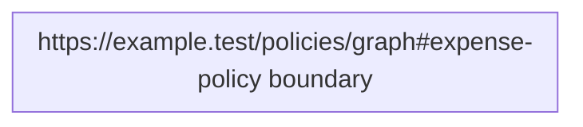

# C4 context view

Catalog commit: `13c91eac591164b5c6cb8b25c5cf940df293d47e`
Registry commit: `13c91eac591164b5c6cb8b25c5cf940df293d47e`
View digest: 6e683d1bb41e11ec736741c0e128c23f48643d770d72d5f5e6ecb136ae9f31e3

Legend: dashed relationships are inferred and tentative; architect-inspected code is separately identified.

## Evidence

| Item | Assertion / basis | Repository | Commit | Source | Blob |
| --- | --- | --- | --- | --- | --- |

## Coverage

| Source | Scope | Status | Reason |
| --- | --- | --- | --- |
| fixture/operations | pages/** | covered |  |
| fixture/policies | pages/** | covered |  |

## Gaps

| Code | Source | Scope | Reason |
| --- | --- | --- | --- |
| unsupported-focus | fixture/policies |  | Focus lacks the required supported mapping |
