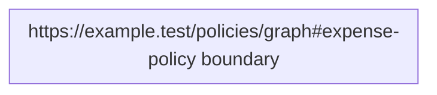

# C4 context view

Catalog commit: `13c91eac591164b5c6cb8b25c5cf940df293d47e`
Registry commit: `13c91eac591164b5c6cb8b25c5cf940df293d47e`
View digest: c27eba9135b14935168bf646ea1aed06378c7a5d41d1c76189b3b60e95b8e71c

Legend: dashed relationships are inferred and tentative; architect-inspected code is separately identified.

## Evidence

| Item | Assertion / basis | Repository | Commit | Source | Blob |
| --- | --- | --- | --- | --- | --- |

## Coverage

| Source | Scope | Status | Reason |
| --- | --- | --- | --- |
| fixture/operations | pages/** | covered |  |
| fixture/policies | pages/** | covered |  |

## Gaps

| Code | Source | Scope | Reason |
| --- | --- | --- | --- |
| no-c4-mapping | fixture/policies |  | Node has no C4 mapping; C4 views need a reviewed mapping |
