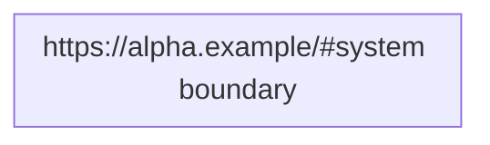

# C4 context view

Catalog commit: `placeholder`
Registry commit: `f8df41df4e41c57c58ea600bb8b52b52b988fb02`
View digest: b42ac10a7a58a163a89631e2ffeb04d3b4eda386db3750a3711c8c6ee3ab1eda

Legend: dashed relationships are inferred and tentative; architect-inspected code is separately identified.

## Evidence

| Item | Assertion / basis | Repository | Commit | Source | Blob |
| --- | --- | --- | --- | --- | --- |

## Coverage

| Source | Scope | Status | Reason |
| --- | --- | --- | --- |

## Gaps

| Code | Source | Scope | Reason |
| --- | --- | --- | --- |
| unsupported-node | fixture/Alpha |  | Mapping support is unavailable |
| empty-level |  |  | No supported items at this level; coverage is unknown |
