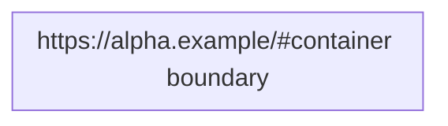

# C4 component view

Catalog commit: `placeholder`
Registry commit: `f8df41df4e41c57c58ea600bb8b52b52b988fb02`
View digest: 5bd05076a0944c81f3ba9d2d342fc3b42453206316d43ebace119d594a95b47b

Legend: dashed relationships are inferred and tentative; architect-inspected code is separately identified.

## Evidence

| Item | Assertion / basis | Repository | Commit | Source | Blob |
| --- | --- | --- | --- | --- | --- |

## Coverage

| Source | Scope | Status | Reason |
| --- | --- | --- | --- |

## Gaps

| Code | Source | Scope | Reason |
| --- | --- | --- | --- |
| unsupported-node | fixture/Alpha |  | Mapping support is unavailable |
| empty-level |  |  | No supported items at this level; coverage is unknown |
