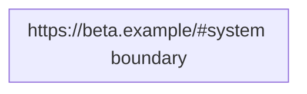

# C4 container view

Catalog commit: `e63348017b778e678b0c349160b8ec2bbc659ff5`
Registry commit: `e63348017b778e678b0c349160b8ec2bbc659ff5`
View digest: 28dae46728b613520aa4ca71362d083767ff26d0686f9d76f235329e9fb64e37

Legend: dashed relationships are inferred and tentative; architect-inspected code is separately identified.

## Evidence

| Item | Assertion / basis | Repository | Commit | Source | Blob |
| --- | --- | --- | --- | --- | --- |

## Coverage

| Source | Scope | Status | Reason |
| --- | --- | --- | --- |
| fixture/Alpha | src/** | covered |  |
| fixture/Beta | src/** | covered |  |

## Gaps

| Code | Source | Scope | Reason |
| --- | --- | --- | --- |
| no-c4-mapping | fixture/Beta |  | Node has no C4 mapping; C4 views need a reviewed mapping |
