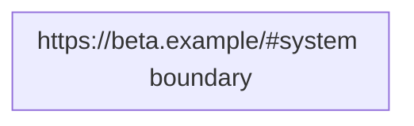

# C4 container view

Catalog commit: `e63348017b778e678b0c349160b8ec2bbc659ff5`
Registry commit: `e63348017b778e678b0c349160b8ec2bbc659ff5`
View digest: 89d2738a366688eacb735a30e42c25567703a1e833fad62922b317c41448ff9f

Legend: dashed relationships are inferred and tentative; architect-inspected code is separately identified.

## Evidence

| Item | Assertion / basis | Repository | Commit | Source | Blob |
| --- | --- | --- | --- | --- | --- |

## Coverage

| Source | Scope | Status | Reason |
| --- | --- | --- | --- |
| fixture/Alpha | src/** | covered |  |
| fixture/Beta | src/** | covered |  |

## Gaps

| Code | Source | Scope | Reason |
| --- | --- | --- | --- |
| unsupported-focus | fixture/Beta |  | Focus lacks the required supported mapping |
