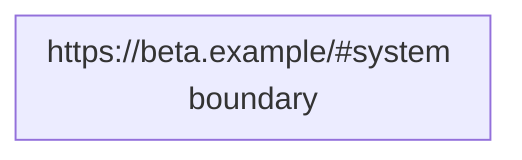

# C4 container view

Catalog commit: `placeholder`
Registry commit: `f8df41df4e41c57c58ea600bb8b52b52b988fb02`
View digest: 0a85a114b29c4c6188504bb99f7b52e2d800b0fbed16e13a71e18f5d180d91d8

Legend: dashed relationships are inferred and tentative; architect-inspected code is separately identified.

## Evidence

| Item | Assertion / basis | Repository | Commit | Source | Blob |
| --- | --- | --- | --- | --- | --- |

## Coverage

| Source | Scope | Status | Reason |
| --- | --- | --- | --- |

## Gaps

| Code | Source | Scope | Reason |
| --- | --- | --- | --- |
| unsupported-focus | fixture/Beta |  | Focus lacks the required supported mapping |
