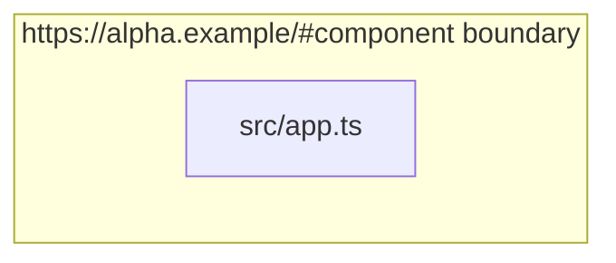

# C4 code view

Catalog commit: `placeholder`
Registry commit: `f8df41df4e41c57c58ea600bb8b52b52b988fb02`
View digest: ee9874ac8598b8d3a1128487d42acccf261c56611a21e014822b871b941cf2c2

Legend: dashed relationships are inferred and tentative; architect-inspected code is separately identified.

## Evidence

| Item | Assertion / basis | Repository | Commit | Source | Blob |
| --- | --- | --- | --- | --- | --- |
| src/app.ts | architect-inspected | fixture/Alpha | 980b69eca326c7bc54d4c8e34aa067b6fd509409 | [src/app.ts:1-1](https://github.com/fixture/Alpha/blob/980b69eca326c7bc54d4c8e34aa067b6fd509409/src/app.ts#L1) | 129fbfa125de7a8b2b24c3dbc34ef5d0e0570747 |

## Coverage

| Source | Scope | Status | Reason |
| --- | --- | --- | --- |

## Gaps

| Code | Source | Scope | Reason |
| --- | --- | --- | --- |
| unsupported-node | fixture/Alpha |  | Mapping support is unavailable |
