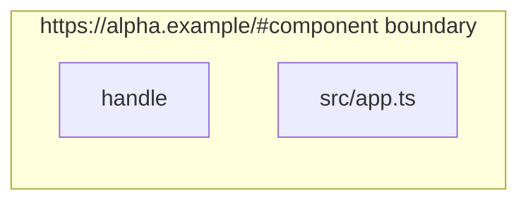

# C4 code view

Catalog commit: `e63348017b778e678b0c349160b8ec2bbc659ff5`
Registry commit: `e63348017b778e678b0c349160b8ec2bbc659ff5`
View digest: 071fa8115e8a04ba4db0935e39c09a9f7ce214b7ad817e43e20a8647b032b313

Legend: dashed relationships are inferred and tentative; architect-inspected code is separately identified.

## Evidence

| Item | Assertion / basis | Repository | Commit | Source | Blob |
| --- | --- | --- | --- | --- | --- |
| handle | https://alpha.example/#contains3 | fixture/Alpha | 980b69eca326c7bc54d4c8e34aa067b6fd509409 | [src/app.ts:1-1](https://github.com/fixture/Alpha/blob/980b69eca326c7bc54d4c8e34aa067b6fd509409/src/app.ts#L1) | 129fbfa125de7a8b2b24c3dbc34ef5d0e0570747 |
| src/app.ts | architect-inspected | fixture/Alpha | 980b69eca326c7bc54d4c8e34aa067b6fd509409 | [src/app.ts:1-1](https://github.com/fixture/Alpha/blob/980b69eca326c7bc54d4c8e34aa067b6fd509409/src/app.ts#L1) | 129fbfa125de7a8b2b24c3dbc34ef5d0e0570747 |

## Coverage

| Source | Scope | Status | Reason |
| --- | --- | --- | --- |
| fixture/Alpha | src/** | covered |  |
| fixture/Beta | src/** | covered |  |

## Gaps

| Code | Source | Scope | Reason |
| --- | --- | --- | --- |
| None recorded | | | Coverage does not establish architectural completeness. |
