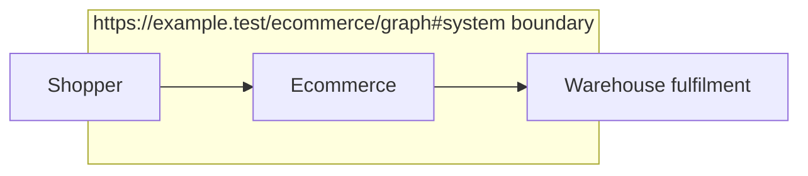

# C4 context view

Catalog commit: `7442de3a6a7929f51124be38bff0f7709207a9ef`
Registry commit: `7442de3a6a7929f51124be38bff0f7709207a9ef`
View digest: c9e9f6bf03c294dd04520a0b5cf111c7c64137312e40bb67e2f07649353414ca

Legend: dashed relationships are inferred and tentative; architect-inspected code is separately identified.

## Evidence

| Item | Assertion / basis | Repository | Commit | Source | Blob |
| --- | --- | --- | --- | --- | --- |
| Warehouse fulfilment | https://example.test/ecommerce/graph#connects | fixture/ecommerce | 54666d869c335bd01817d5780feed7ea80bb82be | [docs/architecture.md:1-5](https://github.com/fixture/ecommerce/blob/54666d869c335bd01817d5780feed7ea80bb82be/docs/architecture.md#L1-L5) | 6365581ca2babd6f039e1c5b476f0ee8e24a20a0 |
| Shopper | https://example.test/ecommerce/graph#uses | fixture/ecommerce | 54666d869c335bd01817d5780feed7ea80bb82be | [docs/acceptance-architecture.md:1-5](https://github.com/fixture/ecommerce/blob/54666d869c335bd01817d5780feed7ea80bb82be/docs/acceptance-architecture.md#L1-L5) | c18767a9dc1fb28a12fed1390185f31bd740b30b |
| Ecommerce | https://example.test/ecommerce/graph#contains-system | fixture/ecommerce | 54666d869c335bd01817d5780feed7ea80bb82be | [docs/architecture.md:1-5](https://github.com/fixture/ecommerce/blob/54666d869c335bd01817d5780feed7ea80bb82be/docs/architecture.md#L1-L5) | 6365581ca2babd6f039e1c5b476f0ee8e24a20a0 |
| https://ontology-kit.dev/schema#communicates-with | https://example.test/ecommerce/graph#connects / direct | fixture/ecommerce | 54666d869c335bd01817d5780feed7ea80bb82be | [docs/architecture.md:1-5](https://github.com/fixture/ecommerce/blob/54666d869c335bd01817d5780feed7ea80bb82be/docs/architecture.md#L1-L5) | 6365581ca2babd6f039e1c5b476f0ee8e24a20a0 |
| https://ontology-kit.dev/schema#communicates-with | https://example.test/ecommerce/graph#uses / direct | fixture/ecommerce | 54666d869c335bd01817d5780feed7ea80bb82be | [docs/acceptance-architecture.md:1-5](https://github.com/fixture/ecommerce/blob/54666d869c335bd01817d5780feed7ea80bb82be/docs/acceptance-architecture.md#L1-L5) | c18767a9dc1fb28a12fed1390185f31bd740b30b |

## Coverage

| Source | Scope | Status | Reason |
| --- | --- | --- | --- |
| fixture/accounting | src/** | unknown | No application code is included in this synthetic fixture. |
| fixture/accounting | docs/** | covered |  |
| fixture/accounting | private/** | excluded | Private integration details are deliberately omitted. |
| fixture/ecommerce | src/** | unknown | No application code is included in this synthetic fixture. |
| fixture/ecommerce | docs/** | covered |  |
| fixture/ecommerce | private/** | excluded | Private integration details are deliberately omitted. |
| fixture/warehouse | src/** | unknown | No application code is included in this synthetic fixture. |
| fixture/warehouse | docs/** | covered |  |
| fixture/warehouse | private/** | excluded | Private integration details are deliberately omitted. |

## Gaps

| Code | Source | Scope | Reason |
| --- | --- | --- | --- |
| stale-mapping | fixture/ecommerce |  | Mapping support is unavailable |
| coverage-excluded | fixture/accounting | private/** | Private integration details are deliberately omitted. |
| coverage-excluded | fixture/ecommerce | private/** | Private integration details are deliberately omitted. |
| coverage-excluded | fixture/warehouse | private/** | Private integration details are deliberately omitted. |
| coverage-unknown | fixture/accounting | src/** | No application code is included in this synthetic fixture. |
| coverage-unknown | fixture/ecommerce | src/** | No application code is included in this synthetic fixture. |
| coverage-unknown | fixture/warehouse | src/** | No application code is included in this synthetic fixture. |
