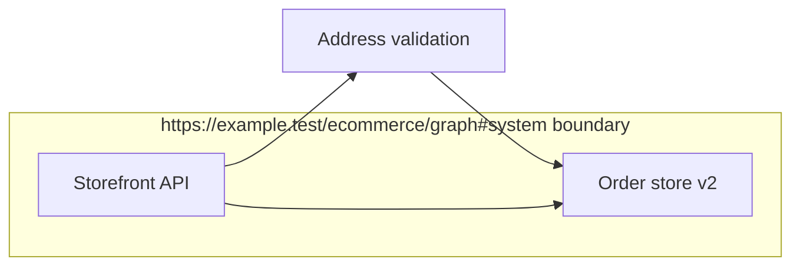

# C4 container view

Catalog commit: `7ba227f2b0cec4fd10747b14f9a377310b51c3da`
Registry commit: `7442de3a6a7929f51124be38bff0f7709207a9ef`
View digest: 03d44665bef7c2a0d3b32998620236f4edaff2f01966928f16e3f405b927ac6c

Legend: dashed relationships are inferred and tentative; architect-inspected code is separately identified.

## Evidence

| Item | Assertion / basis | Repository | Commit | Source | Blob |
| --- | --- | --- | --- | --- | --- |
| Address validation | https://example.test/ecommerce/graph#has-address | fixture/ecommerce | 14eacd71c993188890ea5ac88b99b41794adc6a1 | [docs/acceptance-architecture.md:1-5](https://github.com/fixture/ecommerce/blob/14eacd71c993188890ea5ac88b99b41794adc6a1/docs/acceptance-architecture.md#L1-L5) | 21c826cfa5f5e9d5d3837e4f42e50f491914cb56 |
| Storefront API | https://example.test/ecommerce/graph#contains-system | fixture/ecommerce | 14eacd71c993188890ea5ac88b99b41794adc6a1 | [docs/architecture.md:1-5](https://github.com/fixture/ecommerce/blob/14eacd71c993188890ea5ac88b99b41794adc6a1/docs/architecture.md#L1-L5) | 6365581ca2babd6f039e1c5b476f0ee8e24a20a0 |
| Order store v2 | https://example.test/ecommerce/graph#has-store | fixture/ecommerce | 14eacd71c993188890ea5ac88b99b41794adc6a1 | [docs/acceptance-architecture.md:1-5](https://github.com/fixture/ecommerce/blob/14eacd71c993188890ea5ac88b99b41794adc6a1/docs/acceptance-architecture.md#L1-L5) | 21c826cfa5f5e9d5d3837e4f42e50f491914cb56 |
| https://ontology-kit.dev/schema#contains | https://example.test/ecommerce/graph#has-address / direct | fixture/ecommerce | 14eacd71c993188890ea5ac88b99b41794adc6a1 | [docs/acceptance-architecture.md:1-5](https://github.com/fixture/ecommerce/blob/14eacd71c993188890ea5ac88b99b41794adc6a1/docs/acceptance-architecture.md#L1-L5) | 21c826cfa5f5e9d5d3837e4f42e50f491914cb56 |
| https://ontology-kit.dev/schema#communicates-with | https://example.test/ecommerce/graph#reads / direct | fixture/ecommerce | 14eacd71c993188890ea5ac88b99b41794adc6a1 | [docs/acceptance-architecture.md:1-5](https://github.com/fixture/ecommerce/blob/14eacd71c993188890ea5ac88b99b41794adc6a1/docs/acceptance-architecture.md#L1-L5) | 21c826cfa5f5e9d5d3837e4f42e50f491914cb56 |
| https://ontology-kit.dev/schema#communicates-with | https://example.test/ecommerce/graph#writes / direct | fixture/ecommerce | 14eacd71c993188890ea5ac88b99b41794adc6a1 | [docs/acceptance-architecture.md:1-5](https://github.com/fixture/ecommerce/blob/14eacd71c993188890ea5ac88b99b41794adc6a1/docs/acceptance-architecture.md#L1-L5) | 21c826cfa5f5e9d5d3837e4f42e50f491914cb56 |

## Coverage

| Source | Scope | Status | Reason |
| --- | --- | --- | --- |
| fixture/accounting | src/** | unknown | No application code is included in this synthetic fixture. |
| fixture/accounting | docs/** | covered |  |
| fixture/accounting | private/** | excluded | Private integration details are deliberately omitted. |
| fixture/ecommerce | src/** | unknown | No application code is included in this synthetic fixture. |
| fixture/ecommerce | docs/** | covered |  |
| fixture/ecommerce | private/** | excluded | Private integration details are deliberately omitted. |
| fixture/warehouse | src/** | unknown | No application code is included in this synthetic fixture. |
| fixture/warehouse | docs/** | covered |  |
| fixture/warehouse | private/** | excluded | Private integration details are deliberately omitted. |

## Gaps

| Code | Source | Scope | Reason |
| --- | --- | --- | --- |
| stale-mapping | fixture/ecommerce |  | Mapping support is unavailable |
| coverage-excluded | fixture/accounting | private/** | Private integration details are deliberately omitted. |
| coverage-excluded | fixture/ecommerce | private/** | Private integration details are deliberately omitted. |
| coverage-excluded | fixture/warehouse | private/** | Private integration details are deliberately omitted. |
| coverage-unknown | fixture/accounting | src/** | No application code is included in this synthetic fixture. |
| coverage-unknown | fixture/ecommerce | src/** | No application code is included in this synthetic fixture. |
| coverage-unknown | fixture/warehouse | src/** | No application code is included in this synthetic fixture. |
