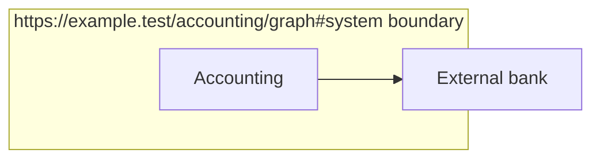

# C4 context view

Catalog commit: `7442de3a6a7929f51124be38bff0f7709207a9ef`
Registry commit: `7442de3a6a7929f51124be38bff0f7709207a9ef`
View digest: 4cc1ea51d21ed437954d9a534571e4e543c10f6aefa777c64defcdd888f3bb81

Legend: dashed relationships are inferred and tentative; architect-inspected code is separately identified.

## Evidence

| Item | Assertion / basis | Repository | Commit | Source | Blob |
| --- | --- | --- | --- | --- | --- |
| External bank | https://example.test/accounting/graph#connects | fixture/accounting | 83f662d094ed66762c4ed3fcbacb122c88c1b5ea | [docs/architecture.md:1-5](https://github.com/fixture/accounting/blob/83f662d094ed66762c4ed3fcbacb122c88c1b5ea/docs/architecture.md#L1-L5) | e063d41dafaf8efc26289ff508b429029e8b85f9 |
| Accounting | https://example.test/accounting/graph#contains-system | fixture/accounting | 83f662d094ed66762c4ed3fcbacb122c88c1b5ea | [docs/architecture.md:1-5](https://github.com/fixture/accounting/blob/83f662d094ed66762c4ed3fcbacb122c88c1b5ea/docs/architecture.md#L1-L5) | e063d41dafaf8efc26289ff508b429029e8b85f9 |
| https://ontology-kit.dev/schema#communicates-with | https://example.test/accounting/graph#connects / direct | fixture/accounting | 83f662d094ed66762c4ed3fcbacb122c88c1b5ea | [docs/architecture.md:1-5](https://github.com/fixture/accounting/blob/83f662d094ed66762c4ed3fcbacb122c88c1b5ea/docs/architecture.md#L1-L5) | e063d41dafaf8efc26289ff508b429029e8b85f9 |

## Coverage

| Source | Scope | Status | Reason |
| --- | --- | --- | --- |
| fixture/accounting | src/** | unknown | No application code is included in this synthetic fixture. |
| fixture/accounting | docs/** | covered |  |
| fixture/accounting | private/** | excluded | Private integration details are deliberately omitted. |
| fixture/ecommerce | src/** | unknown | No application code is included in this synthetic fixture. |
| fixture/ecommerce | docs/** | covered |  |
| fixture/ecommerce | private/** | excluded | Private integration details are deliberately omitted. |
| fixture/warehouse | src/** | unknown | No application code is included in this synthetic fixture. |
| fixture/warehouse | docs/** | covered |  |
| fixture/warehouse | private/** | excluded | Private integration details are deliberately omitted. |

## Gaps

| Code | Source | Scope | Reason |
| --- | --- | --- | --- |
| stale-mapping | fixture/ecommerce |  | Mapping support is unavailable |
| coverage-excluded | fixture/accounting | private/** | Private integration details are deliberately omitted. |
| coverage-excluded | fixture/ecommerce | private/** | Private integration details are deliberately omitted. |
| coverage-excluded | fixture/warehouse | private/** | Private integration details are deliberately omitted. |
| coverage-unknown | fixture/accounting | src/** | No application code is included in this synthetic fixture. |
| coverage-unknown | fixture/ecommerce | src/** | No application code is included in this synthetic fixture. |
| coverage-unknown | fixture/warehouse | src/** | No application code is included in this synthetic fixture. |
